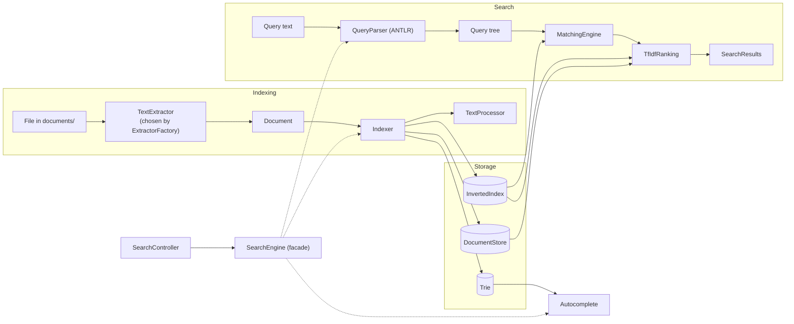

# Search Engine

[](../../actions/workflows/ci.yml)


A search engine for a folder of documents, written from scratch in Java and served as a
Spring Boot REST API. It extracts the text from each file, builds an inverted index, and
answers boolean and phrase queries ranked by TF-IDF. There is no Lucene or Elasticsearch
underneath: the inverted index, document store, trie and query tree are all implemented
and tested here.

Built for CSC322. The brief is in [`CSC322_final_project.pdf`](CSC322_final_project.pdf)
and the design in [`CSC322_search_engine_class_diagram.pdf`](CSC322_search_engine_class_diagram.pdf).

## Features

- **Ten file formats**: PDF, Word (`.doc`, `.docx`), PowerPoint (`.ppt`, `.pptx`, `.pps`,
  `.ppsx`), Excel (`.xls`, `.xlsx`), plain text, HTML and XML, read with Apache Tika.
- **Boolean queries**: `AND`, `OR`, `NOT`, brackets, and words side by side meaning AND.
- **Phrase search**: postings keep word positions, so `"machine learning"` only matches
  documents where the two words are next to each other.
- **TF-IDF ranking** with snippets around the matched word.
- **Autocomplete** from a trie of every indexed word, most common first.
- **Uploads**: a file posted to the API is saved and searchable straight away.
- **Health checks** at `/actuator/health`.

## Running it

You need Java 25. Maven comes with the project (`mvnw`).

```bash
./mvnw spring-boot:run      # starts on http://localhost:8080
./mvnw test                 # runs the tests
./mvnw clean package        # builds target/SearchEngine-0.0.1-SNAPSHOT.jar
```

On Windows use `mvnw.cmd` instead of `./mvnw`.

The index starts empty. Index the `documents/` folder once after starting:

```bash
curl -X POST localhost:8080/api/v1/index/refresh
curl "localhost:8080/api/v1/search?q=computer"
```

## API

Everything is under `/api/v1`. `GET /api/v1` lists the endpoints.

| Method | Path | What it does |
|---|---|---|
| GET | `/search?q=&page=1&size=10` | ranked results; `size` is at most 100 |
| GET | `/autocomplete?q=&limit=` | word suggestions for a prefix |
| GET | `/documents/{id}` | a document's title and extracted text |
| GET | `/files/{id}?download=false` | the original file, shown inline or downloaded |
| POST | `/documents` | upload a file (multipart field `file`); it is indexed immediately |
| POST | `/index/refresh` | rescan the whole document folder |

A document's id is its path inside the document folder, e.g. `reports/annual.pdf`, and is
used as-is in the URL: `/api/v1/documents/reports/annual.pdf`.

Example search response:

```json
{
  "query": "computer",
  "totalHits": 1,
  "tookMillis": 6,
  "results": [
    {
      "documentID": "computer-science-department.html",
      "title": "Department of Computer Science",
      "snippet": "Department of Computer Science The Department of Computer Science offers undergraduate and…",
      "rankingScore": 0.3745
    }
  ]
}
```

Errors all have the same shape:

```json
{"status": 404, "error": "Not Found", "message": "no document with id x.txt",
 "path": "/api/v1/documents/x.txt", "timestamp": "2026-10-27T15:18:57Z"}
```

| Status | When |
|---|---|
| 400 | missing or invalid parameter, e.g. `page=0` or `size=500` |
| 404 | unknown document id |
| 415 | uploaded file type isn't supported |
| 422 | the file couldn't be read (corrupt or not what its extension says) |
| 413 | upload larger than 50 MB |

## Query syntax

| Query | Matches documents that… |
|---|---|
| `java spring` | contain both words (same as `java AND spring`) |
| `java OR kotlin` | contain either word (`\|` also works) |
| `spring NOT boot` | contain `spring` but not `boot` (`-boot` also works) |
| `"machine learning"` | contain the exact phrase |
| `(java OR kotlin) AND spring` | brackets group as usual |
| `e-mail` | contain the phrase "e mail"; a hyphen inside a word is not NOT |

Operators must be uppercase, so `or` is an ordinary word. Words are lowercased and common
stop words (`the`, `of`, ...) are ignored; the list is in
[`stopwords.txt`](src/main/resources/static/stopwords.txt). A query with a syntax error,
such as an unclosed bracket, doesn't fail: its words are searched with AND.

## Configuration

`src/main/resources/application.yaml`:

| Setting | Default | Meaning |
|---|---|---|
| `search.repository-path` | `./documents` | folder that gets indexed and where uploads go |
| `search.reindex-interval` | `PT30M` | rescan period; the brief caps it at 2 hours |
| `search.autocomplete-limit` | `10` | most suggestions returned |
| `search.cors-allowed-origins` | `*` | sites allowed to call the API from a browser |
| `spring.servlet.multipart.max-file-size` | `50MB` | largest upload |

Any of these can be overridden at start-up, e.g.
`./mvnw spring-boot:run -Dspring-boot.run.arguments=--search.repository-path=/srv/docs`.

## Health

`GET /actuator/health` returns 200 when everything is up and 503 when something isn't.

| Check | Down when |
|---|---|
| `documentRepository` | the document folder is missing or can't be read |
| `searchIndex` | the index and the document store disagree |
| `diskSpace` | less than 10 MB free in the document folder |

`searchIndex` also reports how many documents are indexed and what the last rescan did.

## How it works

Two pipelines share the same storage:



- The index is `term → documentID → Posting(frequency, positions)`. Replacing or removing a
  document is a direct lookup, and document frequency and length are kept up to date while
  indexing, so ranking doesn't compute them per query.
- A word's position counts the stop words that were dropped, so `"state of the art"` still
  needs the two remaining words to be three apart.
- Matching evaluates the query tree: a term looks itself up, AND intersects (smallest set
  first), OR unions, NOT subtracts from all documents, a phrase checks positions.
- Ranking scores `Σ (1 + log tf) · log(N / df)` per document, divided by the square root of
  the document's length, and only builds snippets for the results it returns.

Design patterns: Strategy (extractors, ranking), Factory (`ExtractorFactory`), Interpreter
(query tree), Visitor (ANTLR parse tree to query tree) and Facade (`SearchEngine`).

### Packages

```
com.daveai.searchengine
├── api           SearchController, HomeController, error handling
├── services      SearchEngine facade
├── models        Token, Posting, Document, SearchResult, SearchResponse, ...
├── extraction    TextExtractor per format, ExtractorFactory, DocumentLoader
├── indexing      TextProcessor, Indexer, InvertedIndex, DocumentStore
├── autocomplete  Trie
├── query         QueryParser, Query, ast/ (Term, Phrase, And, Or, Not)
├── matching      MatchingEngine
├── ranking       RankingAlgorithm, TfIdfRanking, SnippetBuilder
├── health        health checks for /actuator/health
├── config        bean wiring, SearchProperties, CORS
└── scheduling    scheduled rescans (not built yet)
```

The query grammar is [`SearchQuery.g4`](src/main/antlr4/com/daveai/searchengine/query/SearchQuery.g4).

## Tests

287 tests, run on every push by GitHub Actions. Each class has a unit test next to it, the
extractors run against a real sample of every format in `src/test/resources/samples/`, and
the API is tested end to end with MockMvc against a temporary document folder.

## Status and limits

- Not built yet: the scheduled rescan (the folder is only indexed on `POST /index/refresh`
  and on upload), a web GUI, and the 0.01 s performance check.
- The index lives in memory and is rebuilt from the files on each rescan.
- Upload and refresh have no authentication. Put the API behind one, and narrow
  `search.cors-allowed-origins`, before exposing it beyond a trusted network.

[`task.md`](task.md) has the full build plan, with a flowchart and notes for each task.

## License

MIT, see [LICENSE](LICENSE).
