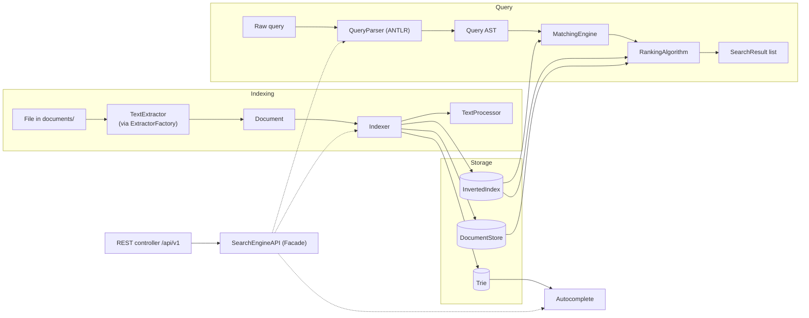

# Search Engine

[](../../actions/workflows/ci.yml)


A from-scratch search engine built as a Spring Boot REST API: it walks a folder of
documents, extracts their text, builds an inverted index, and answers boolean and
phrase queries over it — no Lucene, no Elasticsearch. Every data structure
(inverted index, document store, trie, query AST) is implemented and tested in this
repository.

Built for CSC322. The brief is in [`CSC322_final_project.pdf`](CSC322_final_project.pdf);
the design is in [`CSC322_search_engine_class_diagram.pdf`](CSC322_search_engine_class_diagram.pdf).

---

## Status

Under active development. The indexing side is complete and the query side is
in progress — the REST endpoints are the next milestone and are **not live yet**.

| Component | State |
|---|---|
| Core models (`Token`, `Posting`, `Document`, `SearchResult`) | Done |
| Text extraction — pdf, doc(x), ppt(x)/pps(x), xls(x), txt, html, xml | Done |
| `TextProcessor` — tokenise, normalise, stop-word removal, stemming | Done |
| `InvertedIndex` + `DocumentStore` | Done |
| `Indexer` — the full indexing pipeline | Done |
| `Trie` — prefix autocomplete | Done |
| Query grammar and parser (ANTLR) → AST | Done |
| `MatchingEngine` — AST evaluation | Next |
| TF-IDF ranking and snippets | Planned |
| REST API (`/api/v1/search`) and web GUI | Planned |
| Scheduled re-indexing | Planned |

The full task-by-task plan, with flowcharts and implementation notes for each
finished piece, lives in [`task.md`](task.md).

---

## What it does

- **Indexes a folder of documents.** Point `search.repository-path` at a directory;
  every supported file in it becomes a `Document` with an entry in the index.
- **Reads ten document formats.** PDF, Word (`.doc`, `.docx`), PowerPoint (`.ppt`,
  `.pptx`, `.pps`, `.ppsx`), Excel (`.xls`, `.xlsx`), plain text, HTML and XML, each
  handled by its own `TextExtractor` behind a factory.
- **Understands boolean queries.** `machine AND learning`, `java OR kotlin`,
  `spring NOT boot`, `"exact phrase"`, parentheses for grouping, and two words side
  by side treated as AND. Parsed by an ANTLR grammar into a typed AST.
- **Supports phrase search.** Postings carry term positions, so `"machine learning"`
  matches only documents where the words are adjacent.
- **Autocompletes queries.** A trie is populated as documents are indexed and
  returns ranked prefix suggestions.

---

## Architecture

Two pipelines over shared storage:



### Packages

```
com.daveai.searchengine
├── models        Token, Posting, Document, SearchResult
├── extraction    TextExtractor + per-format extractors, ExtractorFactory, DocumentLoader
├── indexing      TextProcessor, Indexer, InvertedIndex, DocumentStore
├── autocomplete  Trie
├── query         QueryParser, Query, ast/ (Term, Phrase, And, Or, Not)
├── matching      MatchingEngine                    (in progress)
├── ranking       RankingAlgorithm, TfIdfRanking    (planned)
├── api           SearchEngineAPI facade, controller (planned)
├── config        SearchProperties
└── scheduling    repository rescanning            (planned)
```

### Design notes

- **Strategy** for extractors and for ranking, so a new format or a BM25 scorer
  drops in without touching callers.
- **Factory** (`ExtractorFactory`) chooses the extractor from the file extension.
- **Composite + Interpreter** for the query AST: `AndNode`, `OrNode`, `NotNode`,
  `PhraseNode`, `TermNode` are evaluated by the matching engine.
- **Visitor** to turn the ANTLR parse tree into that AST.
- **Facade** (`SearchEngineAPI`) is the single entry point the REST layer talks to.
- The index stores `term → documentID → Posting`, so updating or deleting one
  document is a direct lookup rather than a list scan, and document-frequency and
  document-length statistics are maintained at index time — ranking must not do
  that work during a query.

The query grammar (`src/main/antlr4/.../SearchQuery.g4`):

```antlr
query   : orExpr? EOF ;
orExpr  : andExpr (OR andExpr)* ;
andExpr : notExpr (AND? notExpr)* ;   // two words side by side mean AND
notExpr : NOT notExpr | primary ;
primary : LPAREN orExpr RPAREN | PHRASE | TERM ;
```

---

## Running it

**Requirements:** Java 25 and Maven (the bundled `mvnw` wrapper is fine).

```bash
git clone <this-repo>
cd SearchEngine

./mvnw spring-boot:run      # starts the app on http://localhost:8080
./mvnw test                 # runs the test suite
./mvnw clean package        # builds an executable jar in target/
```

On Windows, use `mvnw.cmd` in place of `./mvnw`.

### Configuration

`src/main/resources/application.yaml`:

```yaml
search:
  repository-path: ./documents   # folder that gets indexed
  reindex-interval: PT30M        # rescan period (the brief caps this at 2 hours)
  autocomplete-limit: 10         # max suggestions returned
```

Drop files into `documents/` to have them indexed. A few samples are included.

---

## Tests

The project is written test-first, as the brief requires. Every component has a unit
test beside it under `src/test/java`, and the extractors are exercised against real
sample files (`src/test/resources/samples/`) — one per supported format. 172 tests
currently pass; they run on every push through GitHub Actions.

```bash
./mvnw test
```

---

## Repository layout

```
documents/                the document repository that gets indexed
src/main/antlr4/          the query grammar
src/main/java/            application code
src/main/resources/       application.yaml, stop-word list
src/test/                 tests and sample documents
task.md                   the full build plan, per-task flowcharts and notes
```

---

## License

MIT — see [LICENSE](LICENSE).
