# Search Engine — Task Plan

This file tracks what gets built, in what order, and how.
It is based on `CSC322_final_project.pdf` (the brief) and `CSC322_search_engine_class_diagram.pdf` (the design).

**How this file is used**

- Each task has a goal, a description, a flowchart, the tests to write first (the brief asks for test-first), and a "done when" check.
- When a task is finished, its **Status** changes and an **Implementation notes** section is added under it, explaining what was built and why.
- Every change is committed.

**Viewing the diagrams**

The diagrams are written in [Mermaid](https://mermaid.js.org/). They show as plain text in editors that don't support it.

- **IntelliJ IDEA:** go to *Settings → Plugins → Marketplace*, install **Mermaid** (by JetBrains) and restart. Then open this file in the Markdown preview: the split or preview icon at the top right of the editor. On older versions, enable it under *Settings → Languages & Frameworks → Markdown → Markdown Extensions → Mermaid*.
- **GitHub** displays Mermaid diagrams automatically.
- You can also paste a single diagram into https://mermaid.live.

---

## 1. Requirements checklist (from the brief)

| #   | Requirement                                                                                  | Covered by   |
|-----|----------------------------------------------------------------------------------------------|--------------|
| R1  | Input types: pdf, doc, docx, ppt, pptx/pps ("ppts" in the brief), xls, xlsx, txt, html, xml  | T5           |
| R2  | Query response time of 0.01 s                                                                | T3, T9, T13  |
| R3  | Query autocomplete                                                                           | T6, T10, T12 |
| R4  | New document indexed within 2 hours of being added                                           | T11          |
| R5  | Keywords extracted with their frequency; stop words excluded                                 | T2, T4       |
| R6  | Query parser that captures the query's meaning, built with a parser generator                | T7           |
| R7  | Relevant documents retrieved and ranked                                                      | T8, T9       |
| R8  | Solution delivered as an API                                                                 | T10          |
| R9  | GUI: search page (text field + button), results on a new page, user can view document content | T12          |
| R10 | ADTs, design patterns, test-first development                                                | All          |

---

## 2. Architecture

There are two pipelines, and they share the same storage.

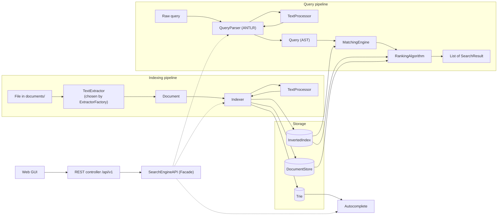

### Proposed package layout

```
com.daveai.searchengine
├── models        Token, Posting, Document, SearchResult
├── indexing      TextProcessor, Indexer, InvertedIndex, DocumentStore
├── extraction    TextExtractor, ExtractorFactory, per-format extractors, DocumentLoader
├── autocomplete  Trie, TrieNode
├── query         QueryParser, Query, ast/ (TermNode, PhraseNode, AndNode, OrNode, NotNode)
├── matching      MatchingEngine
├── ranking       RankingAlgorithm, TfIdfRanking, SnippetBuilder
├── api           SearchEngineAPI (facade), SearchController, DTOs, error handling
├── config        SearchProperties (typed search.* settings)
└── scheduling    RepositoryScanner
src/main/antlr4/com/daveai/searchengine/query/Query.g4
src/main/resources/static/   index.html, results.html, document.html
documents/                   the document repository that gets indexed
```

### Proposed changes to the class diagram

The current diagram is a good base. These gaps show up once the full requirements are applied:

1. **`Posting` gets `positions: List<Integer>`.** Phrase search (`"machine learning"`) needs to know *where* terms occur, not only how often.
2. **`InvertedIndex` and `DocumentStore` get `removeDocument(id)`.** When a file is modified or deleted, its old postings must go away (needed for R4).
3. **`InvertedIndex` keeps ranking statistics:** total document count, document frequency per term, and length per document. TF-IDF needs these, and computing them during a query would break the 0.01 s target.
4. **`Query` becomes a tree (AST)** instead of parallel `terms` / `operators` lists. The diagram's own notes predict this once an ANTLR grammar is used.
5. **`RankingAlgorithm` becomes an interface (Strategy)** with `TfIdfRanking` as the first implementation, so BM25 can be added without touching callers.
6. **`Indexer` also updates the `Trie`.** The diagram says the trie is "populated incrementally as the Indexer processes documents", but draws no arrow between them.
7. **`InvertedIndex` stores `Map<String, Map<String, Posting>>`** (term → documentID → Posting) instead of `Map<String, List<Posting>>`. Updating or deleting a document becomes a direct lookup instead of a list scan, and a document can't appear twice under the same term. `getPostings(term)` still returns that term's postings.

Design patterns used overall: **Facade** (SearchEngineAPI), **Strategy** (extractors, ranking), **Factory** (ExtractorFactory), **Composite + Interpreter** (query AST evaluated by MatchingEngine), **Visitor** (ANTLR parse tree → AST).

---

## 3. Task overview

| ID  | Task                                   | Depends on     | Status      |
|-----|----------------------------------------|----------------|-------------|
| T0  | Project setup and dependencies         | –              | Done        |
| T1  | Core ADTs                              | T0             | Done        |
| T2  | TextProcessor                          | T1             | Done        |
| T3  | InvertedIndex and DocumentStore        | T1             | Done        |
| T4  | Indexer                                | T2, T3, T6     | Done        |
| T5  | Text extraction (Strategy + Factory)   | T1             | Done        |
| T6  | Trie (autocomplete)                    | –              | Done        |
| T7  | Query grammar and parser (ANTLR)       | T2             | Done        |
| T8  | MatchingEngine                         | T3, T7         | Done        |
| T9  | RankingAlgorithm (TF-IDF) and snippets | T3, T7         | Not started |
| T10 | SearchEngineAPI facade and REST API    | T4, T5, T8, T9 | Not started |
| T11 | Scheduled re-indexing (2-hour limit)   | T5, T10        | Not started |
| T12 | Web GUI                                | T10            | Not started |
| T13 | Performance check (0.01 s)             | T10            | Not started |
| T14 | Index persistence (optional)           | T3             | Not started |
| T15 | Documentation deliverables             | All            | Not started |

T1–T4 and T6–T9 are the core ADTs and algorithms — the search engine proper, and about 75% of the work. The rest is supporting infrastructure: dependencies, file-format libraries, scheduling, the UI and the benchmark.

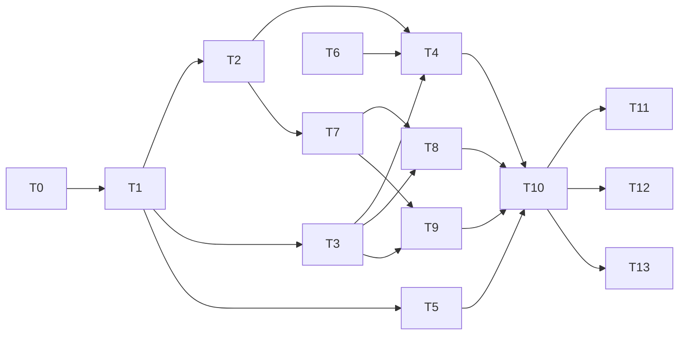

**Milestones**

- **M1 – Indexing core:** T0, T1, T2, T3, T6, T4
- **M2 – Querying:** T7, T8, T9
- **M3 – Real documents and API:** T5, T10, T11
- **M4 – Demo and proof:** T12, T13, T15

---

## 4. Tasks

### T0 — Project setup and dependencies

**Status:** Done

**Goal:** Add the libraries and configuration the other tasks need.

**Description**

- Add dependencies to `pom.xml`:
  - **Apache Tika**, to extract text from pdf/doc/docx/ppt/pptx/xls/xlsx/html/xml. Add `tika-core` plus only the parser modules those formats need: pdf, microsoft, html, xml and text.
  - **ANTLR 4** (`antlr4-runtime` plus `antlr4-maven-plugin`). The plugin generates the parser from `Query.g4` during `mvn compile`, which covers the "parser generator" requirement.
- Add settings to `application.yaml`:
  ```yaml
  search:
    repository-path: ./documents   # folder that gets indexed
    reindex-interval: PT30M        # well within the 2-hour limit
    autocomplete-limit: 10
  ```
- Bind those settings to a typed `SearchProperties` record that rejects invalid values at startup, including an interval over 2 hours.
- Create `documents/` with txt, html and xml samples. Binary samples (pdf and Office formats) are added in T5, where the tests can generate them.
- Create the empty package structure shown in section 2.

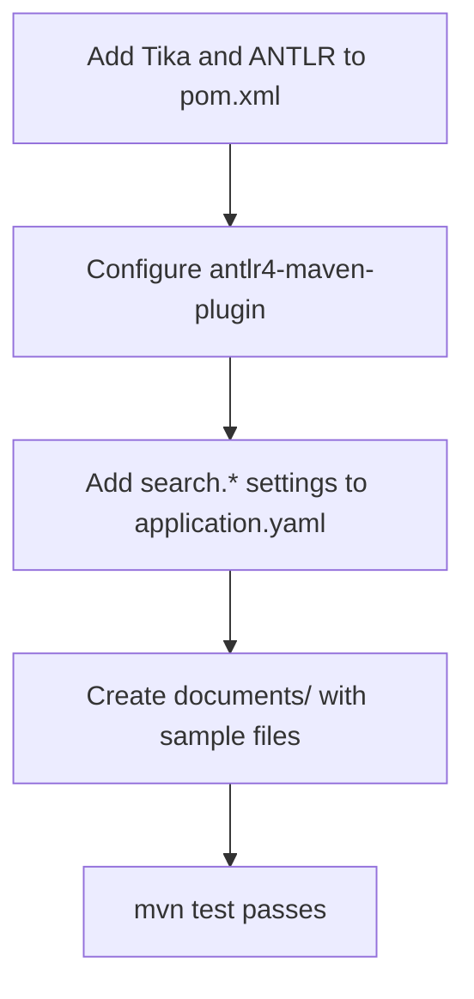

**Done when:** `mvn test` passes and `mvn spring-boot:run` starts with the new dependencies.

#### Implementation notes

**Dependencies (`pom.xml`)**

- **Tika 4.0.0:** `tika-core` plus the parser modules for pdf, Microsoft Office, html (with `tika-encoding-detector-html`), xml and text.
  - In Tika 4, `tika-parsers-standard-package` is only a POM. It pulls in about 25 parser modules, including audio, CAD, OCR, mail and crypto.
  - It also brings `jcl-over-slf4j`, which can clash with Spring's logging.
  - Listing just the modules we need keeps the build small and shows in the POM exactly which formats are supported.
- **ANTLR 4.13.2:** `antlr4-runtime` plus `antlr4-maven-plugin`, with visitor generation on and listener generation off.
  - The plugin looks for grammars in `src/main/antlr4/`.
  - Until T7 adds `Query.g4` it logs "No ANTLR 4 grammars to compile" and the build carries on.

**Settings**

- The `search.*` values in `application.yaml` are bound to the record `config/SearchProperties`. `@ConfigurationPropertiesScan` on `SearchEngineApplication` enables this.
- The record's constructor rejects:
  - missing values
  - an interval of zero or less, or more than 2 hours
  - an autocomplete limit below 1
- A bad setting therefore stops the app at startup with a clear message, instead of causing problems later.
- Spring turns `./documents` into the path `documents`. Both point to the same folder.

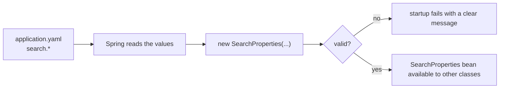

**Packages:** each package from section 2 has a `package-info.java`. Git doesn't track empty folders, so this keeps the layout in the repository, and each file states what its package is for.

**Sample documents:** `documents/welcome.txt`, `documents/computer-science-department.html` and `documents/course-catalogue.xml`.

**Tests (11, all passing)**

| Test class                     | Tests | Checks                                                              |
|--------------------------------|-------|---------------------------------------------------------------------|
| `SearchPropertiesTest`         | 6     | Validation rules, including the 2-hour limit                        |
| `SearchPropertiesBindingTests` | 1     | Values from `application.yaml` reach the record                     |
| `TikaDependencyTest`           | 3     | Tika reads text from the txt, html and xml samples. Temporary: T5 replaces it. |
| `SearchEngineApplicationTests` | 1     | The Spring context starts                                           |

**Verified**

- `mvn test`: BUILD SUCCESS.
- `mvn spring-boot:run`: Tomcat starts on port 8080 in about 6 s. `GET /` returns 404, which is expected because no endpoints exist yet.

---

### T1 — Core ADTs

**Status:** Done

**Goal:** Build the four small immutable types used by every other module.

**Description**

Use Java `record`s. They are immutable, which also makes them safe to read from query threads while indexing runs in the background. Put validation in each compact constructor.

| Type           | Fields                                                  | Rules to enforce                                   |
|----------------|---------------------------------------------------------|----------------------------------------------------|
| `Token`        | `value`, `documentId`, `position`                       | `value` not blank; `position >= 0`                 |
| `Posting`      | `documentId`, `frequency`, `positions: List<Integer>`   | `documentId` not blank; `frequency >= 1`; `frequency == positions.size()`; positions `>= 0` and strictly increasing; defensive copy of the list |
| `Document`     | `id`, `title`, `rawText`                                | `id` not blank; `rawText` not null (may be empty)  |
| `SearchResult` | `documentId`, `title`, `snippet`, `score`               | `score >= 0` and not NaN                           |

- A null value throws `NullPointerException`, for example via `Objects.requireNonNull`. An invalid value throws `IllegalArgumentException`.
- `Document` has no `sourcePath`. Its `id` is the file's path relative to `documents/`, so the original file can be found from the id.

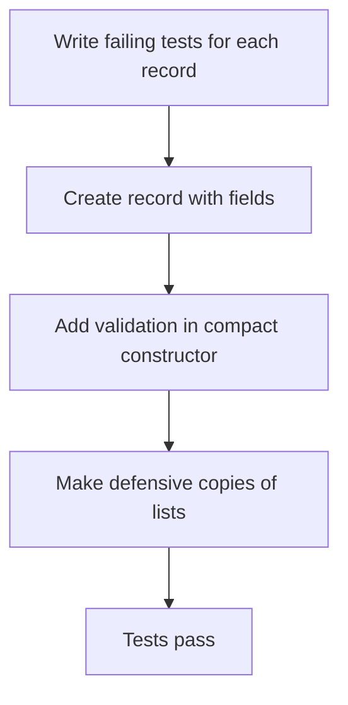

**Tests first**

Written in `src/test/java/com/daveai/searchengine/models/`: `PostingTest`, `TokenTest`, `DocumentTest` and `SearchResultTest`.

- Each rule in the table above has a test.
- A `Posting`'s positions list cannot be changed after construction, either through the original list or through the accessor.
- Two records with equal fields are `equals` and have the same `hashCode`.

**Done when:** all four records exist with tests covering every rule above.

#### Implementation notes

**How the rules are enforced:** each record has a *compact constructor*: a constructor with no parameter list that runs before the fields are assigned. An invalid object therefore can't be created at all.

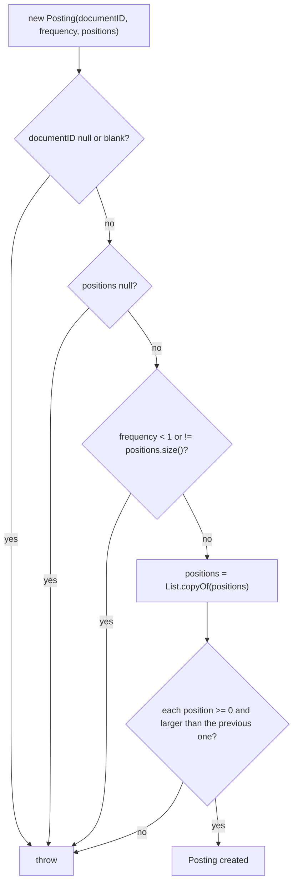

**Decisions**

- **`Posting` copies its list** with `List.copyOf`. The copy can't be modified, and changing the caller's original list no longer affects the index. The ordering check runs on this copy.
- **Positions must be strictly increasing** (for example `[1, 5, 9]`). Phrase matching in T8 relies on reading positions in order.
- **`SearchResult` rejects NaN scores.** `score < 0` alone is false for NaN, so the check is `Double.isNaN(score) || score < 0`.
- **`Token` doesn't validate `documentID`.** Query tokens (T2/T7) might not belong to any document.
- **`Document` allows empty `rawText`,** so a file with no extractable text can still be found by its title.

**Field names:** these stay as you wrote them: `documentID`, and `Token.positions` for a single position. Renaming them to `documentId` and `position` is still recommended. Use Shift+F6 in IntelliJ, which renames every usage including the tests.

**Tests:** 28 model tests plus the 11 from T0. All 39 pass (`mvn test`: BUILD SUCCESS).

---

### T2 — TextProcessor

**Status:** Done

**Goal:** Turn raw text into normalised `Token`s. The same code runs for documents and queries, so their terms always match.

**Description**

`processText` **never reads a file.** By the time it runs, the text has already been extracted from the file (T5) and is passed in as a `String`. `documentID` is only a label copied onto every `Token`, so the index knows which document each word came from.

**Once, in the constructor**

- Load `src/main/resources/static/stopwords.txt` (one word per line) into a `Set<String>`.
  - It is loaded from the classpath with `new ClassPathResource("static/stopwords.txt")`.
  - It is in `static/` on purpose: Spring serves that folder publicly, so anyone can view the list at `/stopwords.txt`.
  - A `Set` makes each "is this a stop word?" check O(1).

**On every call to `processText(text, documentID)`**

1. If `text` is null or blank, return an empty list.
2. Split `text` into words with the regex `[^\p{L}\p{N}]+`: anything that is not a letter or digit separates words. Unicode classes keep non-English letters.
3. Create an empty list `tokens` and a counter `position = 0`.
4. For each word, in order:
   1. **If the word is empty, skip it and don't count it.** Java's `split` returns `""` as the first element when the text starts with punctuation: `", hello"` gives `["", "hello"]`.
   2. Lowercase it with `toLowerCase(Locale.ROOT)`.
   3. If it is **not** a stop word, add `new Token(word, documentID, position)`. *(Optional: stem it first, e.g. Porter, so "running" matches "run".)*
   4. Add 1 to `position`. **This happens for every real word, stop words included.**
5. Return `tokens`.

**Why stop words still move the counter:** positions must describe the *original* text, or phrase search (T8) breaks. In "state of the art", "state" is at 0 and "art" is at 3. If stop words didn't count, "art" would be at 1 and look like it comes straight after "state".

**Worked example: `processText("The cat sat on the mat.", "doc-1")`**

| Word from split | Lowercased | `position` | Stop word? | Token added |
|-----------------|------------|------------|------------|-------------|
| `The`           | `the`      | 0          | yes        | –           |
| `cat`           | `cat`      | 1          | no         | `cat@1`     |
| `sat`           | `sat`      | 2          | no         | `sat@2`     |
| `on`            | `on`       | 3          | yes        | –           |
| `the`           | `the`      | 4          | yes        | –           |
| `mat`           | `mat`      | 5          | no         | `mat@5`     |

The `.` after "mat" is a separator, so it disappears. Java also drops trailing empty strings, so nothing extra appears at the end.

Result: `[Token("cat","doc-1",1), Token("sat","doc-1",2), Token("mat","doc-1",5)]`

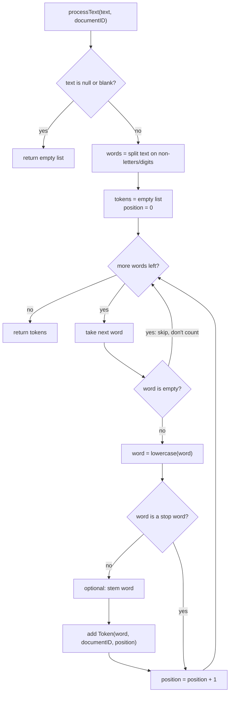

**Tests first**

- `"The cat sat on the mat"` gives `cat@1, sat@2, mat@5`.
- Punctuation and mixed case: `"Hello, WORLD!"` gives `hello@0, world@1`.
- Leading punctuation doesn't shift positions: `", hello world"` gives `hello@0, world@1`.
- Null, empty and whitespace-only text give an empty list.
- Numbers are kept: `"CSC322 project"` gives `csc322@0, project@1`.
- A string made only of stop words gives an empty list.
- Every token carries the `documentID` that was passed in.

**Done when:** tests pass and the stop-word list is loaded from the resource file.

#### Implementation notes

**How it works:** `indexing/TextProcessor.java` follows the steps and flowchart above.

- **Constructor:** reads `static/stopwords.txt` from the classpath once and keeps the words in a `Set`.
- **`processText`:**
  - Returns an empty list for null or empty text.
  - Splits the text with a precompiled `Pattern` (`[^\p{L}\p{N}]+`).
  - Skips empty pieces, and lowercases each word with `Locale.ROOT`.
  - Adds a `Token` for each word that isn't a stop word.
  - Increases `position` for **every** word, stop words included.

**Decisions**

- **Stop words live in `static/`** so the list is public at `http://localhost:8080/stopwords.txt`. A test makes sure it stays reachable.
- **The regex is compiled once** as a constant (`WORD_SEPARATOR`). `String.split` would recompile it on every call, and queries have a 0.01 s target.
- **`Locale.ROOT` for lowercasing.** Plain `toLowerCase()` depends on the machine's language setting (for example, Turkish turns `I` into `ı`), which would make document and query terms stop matching.
- **A null `documentID` is allowed,** so the query parser (T7) can use the same method for queries.

**Bugs found in review and fixed**

1. `position++` was inside the stop-word `if`, so stop words didn't count. "state of the art" gave `art@1` instead of `art@3`.
2. `text.isEmpty()` ran before the null check, so `null` threw `NullPointerException`.

**Tests (all 53 in the project pass)**

| Test class                 | Tests | Checks                                                                                          |
|----------------------------|-------|-------------------------------------------------------------------------------------------------|
| `TextProcessorTest`        | 13    | Positions with stop words, punctuation, capitals, leading punctuation, numbers, accented letters, null/blank text, text made only of stop words, `documentID` copied onto tokens (including null) |
| `StopWordsFileServedTests` | 1     | `GET /stopwords.txt` returns 200 and contains the stop words                                     |

---

### T3 — InvertedIndex and DocumentStore

**Status:** Done

**Goal:** Build the storage ADTs. Term lookup must be about O(1), because the 0.01 s target depends on it.

**Description**

**InvertedIndex**

- **Internal data:** `Map<String, Map<String, Posting>>`, meaning term → (documentID → Posting):
  ```
  "search" → { "doc-1": Posting(doc-1, 2, [0, 7]), "doc-4": Posting(doc-4, 1, [3]) }
  ```
  - **Why not `Map<String, List<Posting>>` like the class diagram?** Documents get modified and deleted (T11). With an inner map:
    - removing or replacing one document's posting is a direct delete or put by key, not a scan through a list;
    - adding the same document twice replaces its posting instead of creating a duplicate.
  - The documentID is stored both as the key and inside `Posting`. That's intentional, because `getPostings` returns postings on their own and the ranker needs to know which document each one belongs to.
- **Reverse map:** `Map<String, Set<String>>`, documentID → the terms in that document, so `removeDocument` only visits that document's terms instead of every term in the index.
- **Operations:**
  - `addPosting(term, posting)`: stores the posting under `term` and `posting.documentID()`, records the term in the reverse map, and updates the document's length.
  - `getPostings(term)`: returns that term's postings as an unmodifiable `Collection<Posting>`. `Collections.unmodifiableCollection(inner.values())` avoids copying. **Never null**; empty when the term is unknown.
  - `removeDocument(documentID)`: for each of the document's terms (from the reverse map), remove the document from that term's inner map, and delete the term if its map is now empty. Then remove the document from the reverse map and the lengths.
  - `documentFrequency(term)`: the size of the term's inner map, or 0 if the term is unknown.
  - `documentCount()`: the number of indexed documents.
  - `documentLength(documentID)`: the sum of that document's posting frequencies, which is its number of non-stop-word tokens. 0 if the document is unknown.
  - `allDocumentIds()`: every indexed document id; needed for `NOT` queries.
- **Concurrency:**
  - Use `ConcurrentHashMap` for the outer map, every inner map and the reverse map. Searches can then read while the indexer writes, with no locks and no copying.
  - Create a term's inner map with `computeIfAbsent`.
  - Make `addPosting` and `removeDocument` `synchronized`. Otherwise `removeDocument` could delete an empty term map at the same moment `addPosting` puts a posting into it, and that posting would be lost. Reads stay unsynchronized, so searches never wait.

**DocumentStore**

- `save(doc)`, `get(id)` returning `Optional<Document>`, `getDocs()` returning a copy of all documents, `remove(id)`, `contains(id)` and `size()`.

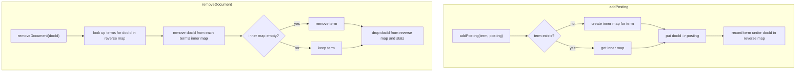

**Tests first**

- An unknown term returns an empty collection, not null.
- Adding postings for two documents under one term returns both.
- After `removeDocument`, the document is gone from every term, and terms with no documents left are gone too.
- `documentFrequency` and `documentCount` stay correct after adds and removes.
- The returned collection cannot be modified by the caller.

**Done when:** both ADTs pass their tests, and the concurrency choice is recorded in the implementation notes.

#### Implementation notes

**InvertedIndex** (`indexing/InvertedIndex.java`) keeps three maps:

| Map               | Shape                          | Purpose                                                           |
|-------------------|--------------------------------|-------------------------------------------------------------------|
| `postings`        | term → (documentID → Posting)  | The index itself                                                  |
| `termsByDocument` | documentID → set of terms      | `removeDocument` visits only that document's terms                |
| `documentLengths` | documentID → token count       | Document length for ranking (T9); the sum of its posting frequencies |

- `addPosting` does three things:
  - stores the posting, creating the term's inner map with `computeIfAbsent`;
  - records the term under the document in `termsByDocument`;
  - updates the length with `merge`. When a posting is replaced, its old frequency is subtracted first.
- `getPostings` returns a read-only view instead of a copy, so queries don't pay for copying. It never returns null.
- `removeDocument` removes the document from each of its terms and deletes terms left with no documents.

**Concurrency decision**

- **Every map is a `ConcurrentHashMap`, in both classes.** A search can loop over postings while the indexer changes them.
  - With a plain `HashMap`, this throws `ConcurrentModificationException`. That was checked in jshell, and `postingsCanBeReadWhileADocumentIsBeingRemoved` tests it.
  - With `ConcurrentHashMap`, reads never lock.
- **`addPosting` and `removeDocument` are `synchronized`.** Each one makes several map calls. Without the lock, a remove could delete a term's empty inner map at the same moment an add is putting a posting into it, and that posting would be lost. Only these two write methods lock, so searches never wait.
- A `ReentrantReadWriteLock` was not used: reads would then have to take a lock too, for no benefit.

**DocumentStore** (`indexing/DocumentStore.java`) is a `ConcurrentHashMap` of document id → `Document`. It is kept separate from the index, so showing a result never re-opens the original file.

Fixed in review:
1. `get` used `Optional.of(documents.get(id))`. That throws `NullPointerException` for an unknown id, because `Optional.of(null)` throws. It now uses `Optional.ofNullable`.
2. `contains` returned `Boolean`. It now returns the primitive `boolean`.
3. `remove` said "document is null" when the id was null. `get` and `contains` now also reject a null id with a clear message.

**Tests (79 in the project, all passing)**

| Test class          | Tests | Checks                                                                                           |
|---------------------|-------|--------------------------------------------------------------------------------------------------|
| `InvertedIndexTest` | 16    | Add/get, several documents per term, replace instead of duplicate, removal and cleanup of empty terms, document frequency/count/length (including after a replace or remove), read-only results, reading during removal, invalid arguments |
| `DocumentStoreTest` | 10    | Save/get, empty `Optional` for an unknown id, replace by id, remove, `contains`, `size`, `getDocs` returns a copy, null arguments |

---

### T4 — Indexer

**Status:** Done

**Goal:** Run the whole indexing pipeline for one `Document`, and undo it when a document is removed.

**Files:** `indexing/Indexer.java` and the test `indexing/IndexerTest.java`.

**Description**

The Indexer doesn't store anything itself. It **coordinates** the four parts you've already built:

```
Document ──► TextProcessor ──► tokens ──► group by term ──► InvertedIndex  (postings)
    │                                            └────────► Trie           (autocomplete)
    └──────────────────────────────────────────────────────► DocumentStore  (title and text)
```

**Constructor:** `Indexer(TextProcessor processor, DocumentStore db, InvertedIndex invertedIndex, Trie trie)`. It is generated by Lombok's `@RequiredArgsConstructor`, so the parameters follow the field order.

- It receives the four objects instead of creating them with `new`.
- The search side (T7–T10) must read the **same** index, store and trie that the Indexer writes to. If the Indexer created its own, searches would look at empty copies.
- This is *dependency injection*; Spring will pass these in automatically in T10.

**Change in `InvertedIndex` (done):** `removeDocument(documentID)` now returns the `Set<String>` of terms it removed, or an empty set if the document wasn't indexed. The Indexer needs those terms to call `trie.remove` for each one, and only the index knows which terms a document had.

**`indexDocument(Document doc)`** is `synchronized`:

1. Reject a null `doc`.
2. **Remove any old version** with `removeDocument(doc.id())`, the Indexer's own method below. If the document was never indexed, this does nothing. Re-indexing a modified file is therefore safe.
3. **Save the document:** `store.save(doc)`. Do this *before* adding postings, so that a search which finds the document can always load its title and text.
4. **Build the text:** title, then a newline, then `rawText`. Use `""` when the title is null. `null + "\n"` would give the text `"null\n"`, and "null" would be indexed as a word.
5. **Tokenise:** `processor.processText(text, doc.id())`.
6. **Group the tokens by term,** keeping their positions in order: `Map<String, List<Integer>>`, filled with `positionsByTerm.computeIfAbsent(token.value(), t -> new ArrayList<>()).add(token.positions())`.
7. **For each term and its positions:**
   1. `index.addPosting(term, new Posting(doc.id(), positions.size(), positions))`. The index also updates the document length.
   2. `trie.insert(term)`, **once per unique term**, so the trie weight equals the number of documents containing the term.

**`removeDocument(String documentID)`** is `synchronized`:

1. `Set<String> terms = index.removeDocument(documentID)`
2. `trie.remove(term)` for each of those terms.
3. `store.remove(documentID)`.

**Worked example:** `indexDocument(new Document("doc-1", "Java Guide", "Java and Spring. Java rocks."))`

| Step | Result |
|------|--------|
| Text | `"Java Guide\nJava and Spring. Java rocks."` |
| Words and positions | java 0, guide 1, java 2, and 3, spring 4, java 5, rocks 6 |
| Tokens ("and" is a stop word) | java@0, guide@1, java@2, spring@4, java@5, rocks@6 |
| Grouped | java → [0, 2, 5], guide → [1], spring → [4], rocks → [6] |
| `addPosting` calls | `java` Posting(doc-1, 3, [0,2,5]), `guide` (1, [1]), `spring` (1, [4]), `rocks` (1, [6]) |
| `trie.insert` calls | java, guide, spring, rocks: 4 calls, one per term |
| `index.documentLength("doc-1")` | 6 |

```mermaid
flowchart TD
    subgraph indexDocument
        A["indexDocument(doc)"] --> B{"doc is null?"}
        B -- yes --> X["throw"]
        B -- no --> C["removeDocument(doc.id())<br/>(does nothing if not indexed)"]
        C --> D["store.save(doc)"]
        D --> E["text = title (or empty) + newline + rawText"]
        E --> F["tokens = processor.processText(text, doc.id())"]
        F --> G["group tokens by term:<br/>term -> list of positions"]
        G --> H{"more terms?"}
        H -- yes --> I["index.addPosting(term,<br/>Posting(doc.id(), positions.size(), positions))"]
        I --> J["trie.insert(term)"]
        J --> H
        H -- no --> K["done"]
    end
    subgraph removeDocument
        R1["removeDocument(documentID)"] --> R2["terms = index.removeDocument(documentID)"]
        R2 --> R3["trie.remove(term) for each term"]
        R3 --> R4["store.remove(documentID)"]
    end
```

**Tests first**

Use in-memory `Document`s here, not files; reading files is T5. Build the Indexer with real `TextProcessor`, `InvertedIndex`, `DocumentStore` and `Trie` instances, keep references to them, and check their contents after each call.

- The body `"java java spring"` gives `java` Posting(freq 2, positions [0, 1]) and `spring` Posting(freq 1, [2]).
- Title words are indexed: the worked example above produces exactly those postings, and a document length of 6.
- A null title does not create a `"null"` term.
- Stop words never reach the index.
- After indexing, the document can be fetched from `DocumentStore`.
- The trie counts documents, not occurrences: doc-1 `"java java jar"` and doc-2 `"java"` give `getSuggestions("ja")` = `[java, jar]`, with java's weight 2, not 3.
- Re-indexing the same id with new text removes the old terms from the index and the trie, adds the new ones, and `documentCount()` stays 1.
- `removeDocument` removes the document from the index, the store and the trie, and leaves other documents untouched.
- Removing an id that was never indexed does nothing.
- A document with empty text is saved in the store but has no postings.
- `InvertedIndex.removeDocument` returns the removed terms, or an empty set for an unknown document.

**Done when:** tests pass using real `TextProcessor`, `InvertedIndex`, `DocumentStore` and `Trie` instances.

#### Implementation notes

**How it works:** `indexing/Indexer.java` follows the steps and flowchart above.

- **`indexDocument`:**
  1. Calls its own `removeDocument` first, which cleans the index, the trie and the store.
  2. Saves the document.
  3. Tokenises `title + "\n" + rawText`, using `""` for a null title.
  4. Groups the positions by term.
  5. For each term, adds one posting and inserts the term into the trie once.
- **`removeDocument`:** takes the terms returned by `invertedIndex.removeDocument`, removes each from the trie, then removes the document from the store.

**Bugs found in review and fixed**

1. **Re-indexing didn't update the trie.** `indexDocument` called `invertedIndex.removeDocument` directly and ignored the returned terms. Old words stayed in autocomplete, and each re-index added another weight to the same document's words: after 3 re-indexes, `java` had weight 3 instead of 1. Fixed by calling the Indexer's own `removeDocument`.
2. **A null title was indexed as the word "null".** `doc.title() + "\n"` turns null into the text "null". Fixed by using `""` when the title is null.

**Decisions**

- **A plain `HashMap` + `ArrayList` for grouping,** instead of `ConcurrentHashMap` + `LinkedList`. The map is a local variable that only one thread uses, so thread-safety overhead is wasted. `ArrayList` is also faster to build and faster for `Posting` to copy. This speeds up indexing (how soon new documents become searchable). It does **not** affect query response time, because the Indexer doesn't run during a search.
- **Both methods are `synchronized`,** so a scheduled rescan (T11) and an upload (T10) can't index or remove documents at the same time. Calling `removeDocument` from inside `indexDocument` is allowed, because Java locks are re-entrant.
- **Title and body are indexed as one text,** with the title first, so title words are searchable.
  - *Known limitation:* a phrase could match across the end of the title and the start of the body. That is acceptable for this project.

**Tests:** `IndexerTest` has 12 tests using real components. They cover:
- grouping repeated words;
- title words with the exact positions and document length from the worked example;
- a null title;
- stop words;
- saving to the store;
- the trie counting documents rather than occurrences;
- re-indexing replacing terms in the index and the trie;
- re-indexing not inflating trie weights;
- removal that keeps other documents;
- removing an unknown document;
- a document with no text;
- a null document.

The project has 108 tests, all passing.

---

### T5 — Text extraction (Strategy + Factory)

**Status:** Done

**Goal:** Turn a file of any supported format into a `Document`, without the Indexer knowing about formats.

**Description**

- `interface TextExtractor { Set<String> supportedExtensions(); ExtractedContent extract(Path file); }`
- Implementations, one Strategy per format family:
  - `PlainTextExtractor`: txt
  - `PdfExtractor`: pdf
  - `WordExtractor`: doc, docx
  - `PowerPointExtractor`: ppt, pptx, pps, ppsx
  - `ExcelExtractor`: xls, xlsx
  - `HtmlExtractor`: html, htm (the `<title>` becomes the document title)
  - `XmlExtractor`: xml

  Each wraps Tika. The separate classes keep the Strategy pattern visible and let each format tune its output.
- `ExtractorFactory.forFile(Path)` picks the extractor by extension and throws `UnsupportedDocumentTypeException` otherwise.
- `DocumentLoader.load(Path)` gives a `Document`:
  - id = path relative to `documents/`
  - title = metadata title, or the file name as a fallback
  - rawText = extracted text

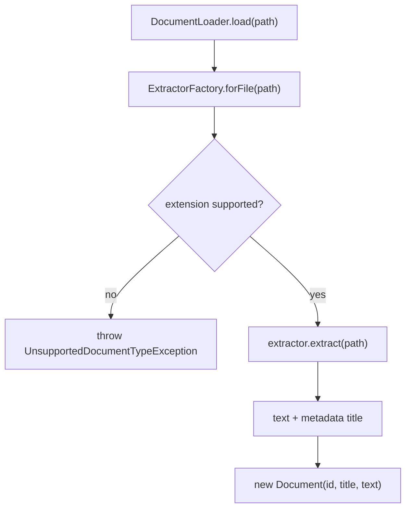

**Tests first**

- One sample file per format in `src/test/resources/samples/`. Each extracts a known sentence.
- An unknown extension throws.
- A file without a metadata title falls back to its file name.

**Done when:** every format in R1 has a passing extraction test.

#### Implementation notes

**Classes** (`extraction/`)

| Class | Role |
|-------|------|
| `TextExtractor` | Strategy interface: `supportedExtensions()` and `extract(Path)` returning `ExtractedContent(text, title)` |
| `TikaTextExtractor` | Abstract base class. Holds a map of extension → Tika `Parser` and runs the parse with `TikaInputStream` + `BodyContentHandler(-1)`. |
| `PlainTextExtractor` | txt → `TXTParser` |
| `PdfExtractor` | pdf → `PDFParser` |
| `WordExtractor` | doc → `OfficeParser`, docx → `OOXMLParser` |
| `PowerPointExtractor` | ppt, pps → `OfficeParser`; pptx, ppsx → `OOXMLParser` |
| `ExcelExtractor` | xls → `OfficeParser`, xlsx → `OOXMLParser` |
| `HtmlExtractor` | html, htm → `JSoupParser` |
| `XmlExtractor` | xml → `XMLParser` |
| `ExtractorFactory` | Factory: extension → extractor. Also `isSupported(path)` for the T11 scanner, and `withDefaultExtractors()`. |
| `DocumentLoader` | File → `Document(id, title, text)` |
| `UnsupportedDocumentTypeException`, `DocumentExtractionException` | Unchecked exceptions: unknown file type, and missing or corrupt file |

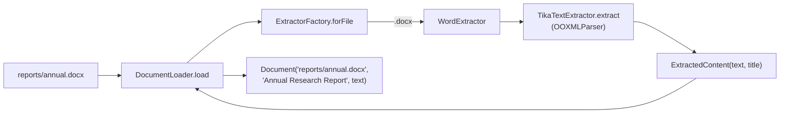

**Decisions**

- **One extractor per format family, each using the specific Tika parser.**
  - `AutoDetectParser` for everything would also work, but it would hide the Strategy pattern and accept formats we don't claim to support.
  - Parsers are stateless, so one instance per extractor is safe to share between threads.
- **Tika 4.0 API differences:**
  - `Parser.parse` now takes a `TikaInputStream` (not a plain `InputStream`).
  - The HTML parser is `JSoupParser`; `HtmlParser` no longer exists.
  - Both were checked against the real jars with jshell reflection.
- **No text length limit** (`BodyContentHandler(-1)`). Tika's default cuts off at 100,000 characters, which would silently leave the end of long documents unindexed.
- **Document id** is the path relative to the repository folder, with forward slashes (for example `reports/2024/annual.docx`).
  - It looks the same on Windows and Linux, can be used in URLs (T10), and leads straight back to the original file.
  - Files outside the repository are rejected.
- **Title** is the metadata title if there is one (HTML `<title>`, Word Title property), otherwise the file name without its extension.
- **"ppts" in the brief** is read as the PowerPoint slide-show formats, pps and ppsx.
- **The temporary `TikaDependencyTest` from T0 was removed.** These tests replace it.

**Sample files** (`src/test/resources/samples/`)

- There are 12 files, one per extension. Each contains "This is the {FORMAT} sample about the inverted index."
- Microsoft Office created the Office and PDF samples (Word, Excel and PowerPoint through PowerShell COM, with the PDF saved from Word), so the tests read real files rather than hand-made imitations.
- `sample.docx` has the Title property "Annual Research Report", and `sample.html` has `<title>HTML Sample Title</title>`.

**Tests (33 new; 138 in the project, all passing)**

| Test class | Tests | Checks |
|------------|-------|--------|
| `TextExtractorsTest` | 19 | The sample sentence from each of the 12 formats (parameterized); HTML and Word titles; XML tags excluded; each extractor's extensions; wrong format, missing file and corrupt file |
| `ExtractorFactoryTest` | 7 | All 13 extensions supported; picks by extension; case-insensitive matching; unsupported extension and no extension; `isSupported`; two extractors claiming the same extension |
| `DocumentLoaderTest` | 7 | Relative id with forward slashes; metadata title; file-name title fallback; extracted text; file outside the repository; unsupported type; **end to end**: all 12 samples loaded and indexed, with "inverted" found in 12 documents |

---

### T6 — Trie (autocomplete)

**Status:** Done

**Goal:** Return suggestions for a prefix quickly (R3).

**Description**

A trie (prefix tree) stores words one letter per node. Words that start the same way share the same path, so every word beginning with a prefix sits under that prefix's node.

**Files:** `autocomplete/Trie.java` (with `TrieNode` as a private nested class, since nothing else uses it) and the test `autocomplete/TrieTest.java`.

**Example:** the trie after indexing, where `java` is in 3 documents, `javascript` in 2 and `jar` in 1:

```
(root)
 └─ j
    └─ a
       ├─ r                          ← "jar"         word, weight 1
       └─ v
          └─ a                       ← "java"        word, weight 3
             └─ s─c─r─i─p─t          ← "javascript"  word, weight 2
```

- `getSuggestions("jav", 10)` walks `j → a → v`, collects every word below that node (`java`, `javascript`) and returns `[java, javascript]`, highest weight first.
- `getSuggestions("ja", 10)` returns `[java, javascript, jar]`.

**`TrieNode`**

- `Map<Character, TrieNode> children`: the next letters.
- `boolean isWord`: true if a word ends at this node.
- `int weight`: how many documents contain the word ending here. Common words are suggested first.

**Weight = document count.** The Indexer (T4) calls `insert(term)` **once per unique term per document**, not once per occurrence. When a document is removed, it calls `remove(term)` once for each of that document's terms. That keeps each weight equal to the number of documents containing the word, the same as `InvertedIndex.documentFrequency`.

**`insert(word)`**

1. Reject a null or blank word.
2. Start at the root.
3. For each letter, move to that child, creating it if it doesn't exist.
4. At the last letter's node, set `isWord = true` and add 1 to `weight`.

**`remove(word)`**

1. Walk to the word's last node, letter by letter. If any letter is missing, or the node isn't a word, do nothing.
2. Subtract 1 from `weight`.
3. If `weight` is now 0, set `isWord = false`, so the word is no longer suggested.
   - Longer words below it, such as `javascript` under `java`, are not affected.
   - *(Optional)* Delete nodes left with no children that aren't words, to save memory.

**`getSuggestions(prefix, limit)`**

1. If `prefix` is null or blank, return an empty list. (Decision: suggesting the whole vocabulary for an empty box is useless and slow.)
2. If `limit < 1`, throw `IllegalArgumentException`.
3. Lowercase the prefix with `Locale.ROOT`. Indexed terms are already lowercase, but user input may not be.
4. Walk from the root, one letter at a time. If a letter is missing, return an empty list.
5. From the prefix's node, collect every word below it with a depth-first search (DFS), building each word letter by letter. The prefix itself counts if it is a word.
6. Sort by weight, highest first; break ties alphabetically.
7. Return the first `limit` words.

**Other points**

- **Multi-word input** such as `"machine lea"`: the API (T10) completes only the last word and keeps the rest. The trie only ever sees single words.
- **Thread safety:** autocomplete reads the trie while the indexer writes. Use the same approach as `InvertedIndex`:
  - `children` is a `ConcurrentHashMap`;
  - `insert` and `remove` are `synchronized`; `getSuggestions` is not;
  - mark `isWord` and `weight` as `volatile`, so a read sees the latest write.
- *(Optional, for speed)* Store the top-N suggestions on each node while inserting, so a lookup doesn't have to search the whole subtree.

```mermaid
flowchart TD
    subgraph insert
        I1["insert(word)"] --> I2{"word null or blank?"}
        I2 -- yes --> I3["throw"]
        I2 -- no --> I4["node = root"]
        I4 --> I5{"more letters?"}
        I5 -- yes --> I6["node = child for letter<br/>(create it if missing)"]
        I6 --> I5
        I5 -- no --> I7["node.isWord = true<br/>node.weight = node.weight + 1"]
    end
    subgraph remove
        R1["remove(word)"] --> R2["walk to word's last node"]
        R2 --> R3{"found and isWord?"}
        R3 -- no --> R4["do nothing"]
        R3 -- yes --> R5["node.weight = node.weight - 1"]
        R5 --> R6{"weight == 0?"}
        R6 -- yes --> R7["node.isWord = false"]
        R6 -- no --> R8["done"]
    end
    subgraph getSuggestions
        S1["getSuggestions(prefix, limit)"] --> S2{"prefix null or blank?"}
        S2 -- yes --> S3["return empty list"]
        S2 -- no --> S4["lowercase prefix"]
        S4 --> S5["walk to prefix's node"]
        S5 --> S6{"found?"}
        S6 -- no --> S3
        S6 -- yes --> S7["DFS: collect every word below the node"]
        S7 --> S8["sort: weight high to low, then A to Z"]
        S8 --> S9["return first limit words"]
    end
```

**Tests first**

- After inserting `java` ×3, `javascript` ×2 and `jar` ×1:
  - the prefix `ja` returns `[java, javascript, jar]`;
  - the prefix `jav` returns `[java, javascript]`.
- The prefix itself is suggested when it is a word: `java` returns `[java, javascript]`.
- An uppercase prefix works: `JA` gives the same result as `ja`.
- An unknown prefix returns an empty list.
- A null, empty or blank prefix returns an empty list.
- Words with equal weight are sorted alphabetically.
- `limit` is respected, and `limit < 1` throws.
- `remove` lowers the weight. The word is still suggested while its weight is above 0, and disappears at 0.
- Removing `java` does not remove `javascript`.
- Removing a word that was never inserted does nothing.
- `insert` rejects a null or blank word.

**Done when:** tests pass.

#### Implementation notes

**Problems found in review.** Before the fix, with `java`, `javascript` and `jar` inserted:

| Call                   | Before                  | After                        |
|------------------------|-------------------------|------------------------------|
| `getSuggestion("ja")`  | `[]`                    | `[java, javascript, jar]`    |
| `getSuggestion("java")`| `[]`                    | `[java, javascript]`         |
| `getSuggestion("JA")`  | `NullPointerException`  | `[java, javascript, jar]`    |
| `getSuggestion("jxy")` | `NullPointerException`  | `[]`                         |

1. **Walking and collecting were mixed in one loop.** The loop stopped at the end of the prefix, so no word longer than the prefix was ever found.
2. **`isWord` was checked before moving to the next letter,** so the prefix's own last node was never checked.
3. **A missing letter set `node` to `null`,** and the next iteration crashed.
4. **A new `StringBuilder` was created on every iteration,** and it only appended a letter when the letter was *missing*.
5. **`toLowerCase` only affected the loop condition;** `charAt` still read the original prefix.
6. **`limit` was checked but never applied.** `remove` was an empty stub.

**How it works now**

- **`insert`:** lowercases the word, then walks down with `computeIfAbsent` (which creates missing nodes), marks the last node as a word and adds 1 to its `weight`.
- **`getSuggestions`** does two separate jobs:
  - **Job 1:** walk down to the prefix's last node, and return an empty list as soon as a letter is missing.
  - **Job 2:** `collect` does a depth-first search from that node. It appends a letter before visiting a child and removes it afterwards, so every child starts from the same letters. The results are then sorted by weight (highest first), ties go A to Z, and the list is cut to `limit`.
- **`remove`:** walks to the word and subtracts 1 from its weight; at 0 it clears `isWord`. Longer words below it (`javascript` under `java`) are untouched. Empty branches are not pruned; they only cost a little memory.

**Decisions**

- **`weight` = number of documents containing the word.** The Indexer (T4) must call `insert` once per unique term per document, and `remove` once per term when a document is removed.
- **`ConcurrentHashMap` for children** (your choice). Letter order in the map doesn't matter, because ties are sorted explicitly.
- **`insert` and `remove` are `synchronized`,** and `isWord`/`weight` are `volatile`. This is the same approach as `InvertedIndex`: reads never wait.
- **A null or blank prefix gives an empty list.** A `limit` below 1 throws.

**Tests:** `TrieTest`, 15 tests.

- ordering by weight
- a narrower prefix narrows the results
- the prefix itself as a word
- case-insensitive prefix and lowercased storage
- unknown and blank prefixes
- ties sorted alphabetically
- the limit, and a limit below 1
- remove: lowering the weight, disappearing at 0, keeping longer words, words that were never inserted
- invalid words

The project has 94 tests, all passing.

---

### T7 — Query grammar and parser (ANTLR)

**Status:** Done

**Goal:** Parse raw query text into a tree that captures what the query means. This covers R6 and the brief's parser-generator requirement.

**Files**

| File | What it is |
|------|------------|
| `src/main/antlr4/com/daveai/searchengine/query/SearchQuery.g4` | The grammar. You write it. |
| `query/ast/QueryNode.java` and 5 node records | The AST: the tree of meaning |
| `query/Query.java` | The parsed query: raw text plus the AST root |
| `query/QueryAstBuilder.java` | The visitor that turns ANTLR's parse tree into the AST |
| `query/QueryParser.java` | The class the rest of the app calls: `parse(raw)` |
| `test/.../query/QueryParserTest.java` | Tests |

- **Generated classes:** during `mvn compile`, ANTLR generates `SearchQueryLexer`, `SearchQueryParser` and `SearchQueryBaseVisitor` into `target/generated-sources/antlr4/`.
  - The folder under `src/main/antlr4/` becomes their package (`com.daveai.searchengine.query`).
  - Never edit or commit the generated files; they are rebuilt on every compile.
- ⚠ **Name the grammar `SearchQuery`, not `Query`.** ANTLR names the generated parser `<grammar name>Parser`. `grammar Query` would therefore generate a class called `QueryParser`, clashing with your own `QueryParser`.

**How the pieces fit**

```
java -spring "machine learning"
   │
   ▼  SearchQueryLexer   (generated)   tokens: TERM(java) NOT TERM(spring) PHRASE("machine learning")
   ▼  SearchQueryParser  (generated)   parse tree, shaped exactly like the grammar rules
   ▼  QueryAstBuilder    (you write)   walks the parse tree, cleans each word with TextProcessor
   ▼
Query(raw, And[ Term(java), Not(Term(spring)), Phrase[machine@0, learning@1] ])
```

- **Parse tree vs AST:**
  - The *parse tree* mirrors the grammar: every rule, bracket and operator token.
  - The *AST* keeps only the meaning: which words, combined how.
  - T8 works on the AST.

**Step 1: the grammar (`SearchQuery.g4`)**

```antlr
grammar SearchQuery;

query   : orExpr? EOF ;
orExpr  : andExpr (OR andExpr)* ;
andExpr : notExpr (AND? notExpr)* ;   // two words side by side mean AND
notExpr : NOT notExpr | primary ;
primary : LPAREN orExpr RPAREN | PHRASE | TERM ;

OR     : 'OR' | '|' ;
AND    : 'AND' | '&' ;
NOT    : 'NOT' | '-' ;
LPAREN : '(' ;
RPAREN : ')' ;
PHRASE : '"' ~["]* '"' ;
TERM   : [\p{L}\p{N}]+ ;
WS     : [ \t\r\n]+ -> skip ;
OTHER  : . -> skip ;                  // ignore any other character: ? , ! ' etc.
```

- **Rule names:** lowercase names (`query`, `orExpr`…) are *parser rules*, which combine tokens. UPPERCASE names (`OR`, `TERM`…) are *lexer rules*, which say what one token looks like.
- **Precedence comes from nesting:** `query → orExpr → andExpr → notExpr → primary`. The deeper the rule, the tighter it binds: NOT first, then AND, then OR. So `java OR spring boot` means `java OR (spring AND boot)`, and brackets override it.
- **Operators are uppercase only.** A lowercase `or` is an ordinary word, and also a stop word.
- **`OTHER` must be the last rule.** When two lexer rules match text of the same length, ANTLR picks the earlier one, so `-` becomes `NOT`, not `OTHER`.
- **Known limitation:** `e-mail` is read as `e NOT mail`. That is acceptable for this project.

**Step 2: the AST (`query/ast/`)**

```java
public sealed interface QueryNode permits TermNode, PhraseNode, AndNode, OrNode, NotNode {}
public record TermNode(String term)                implements QueryNode {}
public record PhraseNode(List<Token> words)        implements QueryNode {}  // word + position within the phrase
public record AndNode(List<QueryNode> children)    implements QueryNode {}
public record OrNode(List<QueryNode> children)     implements QueryNode {}
public record NotNode(QueryNode child)             implements QueryNode {}
```

- **`sealed`** means only these five types can be a `QueryNode`. T8 can then `switch` over them, and the compiler checks that every case is handled.
- **`PhraseNode` keeps positions, not just words.** Stop words are removed from a phrase but still count, exactly as in documents: `"state of the art"` gives `[state@0, art@3]`. A matching document has `state@p` and `art@p+3`. With only `[state, art]` stored, T8 would look for the two words next to each other, and the phrase would never match.

**`Query` (`query/Query.java`):** `record Query(String rawText, QueryNode root)`

- `root` is `null` when nothing searchable is left, for example `the OR of` or an empty box. Add `boolean isEmpty()`, which returns `root == null`.
- `List<String> terms()` returns every word from Term and Phrase nodes, **skipping anything under a NOT**. The ranker (T9) scores documents by these words, and a document shouldn't score higher for containing a word the user excluded.

**Step 3: `QueryAstBuilder extends SearchQueryBaseVisitor<QueryNode>`**

ANTLR generates one `visitXxx` method per parser rule. Override each one to return a `QueryNode`, or `null` when nothing is left (only stop words):

| Rule      | What your `visitXxx` does |
|-----------|---------------------------|
| `query`   | If there is an `orExpr`, visit it; otherwise return `null`. |
| `orExpr`  | Visit each `andExpr` and drop the `null`s. 0 left → `null`; 1 left → return that child; more → `OrNode`. |
| `andExpr` | Same, with `notExpr` children → `AndNode`. |
| `notExpr` | If it starts with `NOT`: visit the inner `notExpr`; `null` → `null`, otherwise `NotNode(child)`. If there is no `NOT`, visit `primary`. |
| `primary` | **Brackets:** visit the inner `orExpr`. **TERM:** `processor.processText(text, null)`; no tokens (a stop word) → `null`, otherwise `TermNode(token.value())`. **PHRASE:** strip the quotes, then `processText`; 0 tokens → `null`, 1 → `TermNode`, more → `PhraseNode(tokens)`. |

A `TERM` contains only letters and digits, so `processText` returns either 0 or 1 token for it.

**Step 4: `QueryParser` (the class the app calls)**

`QueryParser(TextProcessor processor)`, with `Query parse(String raw)`:

1. If `raw` is null or blank, return `new Query(raw, null)`.
2. Create `lexer = new SearchQueryLexer(CharStreams.fromString(raw))`.
3. Create `parser = new SearchQueryParser(new CommonTokenStream(lexer))`.
4. **Make syntax errors throw.** By default ANTLR prints the error to the console and guesses a fix. Call `parser.removeErrorListeners()` and `parser.setErrorHandler(new BailErrorStrategy())`.
5. `try`: `root = new QueryAstBuilder(processor).visit(parser.query())`.
6. `catch (ParseCancellationException e)`: **fall back**. Run `processor.processText(raw, null)` and turn the tokens into an `AndNode` of `TermNode`s. Zero tokens → `null`; one token → a single `TermNode`.
7. Return `new Query(raw, root)`.

**Worked examples**

| Input                         | AST (root) |
|-------------------------------|------------|
| `java spring`                 | `And[Term(java), Term(spring)]` |
| `java OR python`              | `Or[Term(java), Term(python)]` |
| `java OR spring boot`         | `Or[Term(java), And[Term(spring), Term(boot)]]`, which checks precedence |
| `(java OR python) AND spring` | `And[Or[Term(java), Term(python)], Term(spring)]` |
| `java -spring`, `java NOT spring` | `And[Term(java), Not(Term(spring))]` |
| `JAVA`                        | `Term(java)` |
| `"Machine Learning"`          | `Phrase[machine@0, learning@1]` |
| `"state of the art"`          | `Phrase[state@0, art@3]` |
| `the AND java`                | `Term(java)` |
| `what is java?`               | `Term(java)`: `?` is skipped, and "what" and "is" are stop words |
| `the OR of`                   | `null`: an empty query |
| `(java spring`                | syntax error → fallback → `And[Term(java), Term(spring)]` |

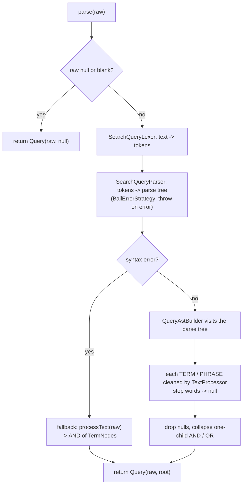

**Tests first**

- Every row in the worked-examples table above.
- `terms()` skips words under NOT: `java -spring` gives `[java]`.
- `null`, `""` and `"   "` give a query where `isEmpty()` is true.
- `(java spring` does not throw.

**Done when:** tests pass, and the parser is generated by Maven during the build rather than committed.

#### Implementation notes

**Where each file comes from**

| File | Source |
|------|---------|
| `src/main/antlr4/com/daveai/searchengine/query/SearchQuery.g4` | Written by hand |
| `SearchQueryLexer`, `SearchQueryParser`, `SearchQueryVisitor`, `SearchQueryBaseVisitor` | Generated by ANTLR during `mvn compile` into `target/generated-sources/antlr4/`. Not committed. |
| `CharStreams`, `CommonTokenStream`, `BailErrorStrategy`, `ParseCancellationException` | The `antlr4-runtime` library |
| `query/ast/*`, `Query`, `QueryAstBuilder`, `QueryParser` | Written by hand |

Each grammar rule becomes a Context class in `SearchQueryParser` (for example `NotExprContext`), and each part of the rule becomes a method on it (`NOT()`, `notExpr()`, `primary()`). `SearchQueryBaseVisitor` has one `visitXxx` method per rule, and `QueryAstBuilder` overrides all five.

**How it works**

- **`QueryParser.parse(raw)`**
  - Blank text gives an empty query.
  - Otherwise: lexer → parser → `QueryAstBuilder.visit(parser.query())`.
  - The parser uses `BailErrorStrategy`, so a syntax error throws `ParseCancellationException`. In that case the fallback builds an AND of the words.
- **`QueryAstBuilder`** has one method per grammar rule. Each returns a `QueryNode`, or `null` when nothing searchable is left.
  - `visitOrExpr` / `visitAndExpr`: visit every part and drop the nulls (`visitAndDropNulls`). Then 0 left → `null`, 1 → that child, more → `OrNode` / `AndNode`.
  - `visitNotExpr`: wraps the inner node in `NotNode`, or returns `null` if the inner node is `null` (`-the`).
  - `visitPrimary`:
    - TERM → `TermNode`.
    - PHRASE → quotes stripped, then `PhraseNode` with positions (a single word gives `TermNode`).
    - Brackets → the inner expression.
- **`Query.isEmpty()`** returns `root == null`.
- **`Query.terms()`** walks the tree with a `switch` over the sealed `QueryNode` and skips everything under a `NotNode`. The compiler checks that every node type is handled.

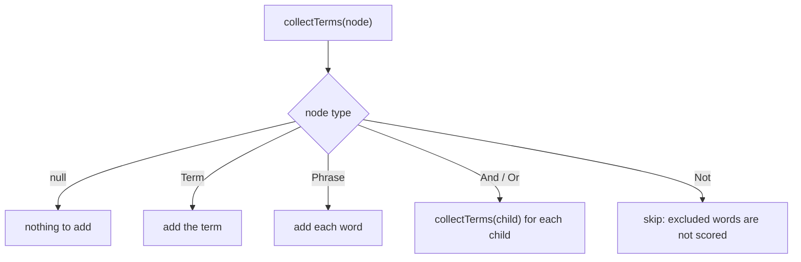

**Decisions**

- **The grammar lives in `src/main/antlr4/`,** the plugin's default folder.
  - No `pom.xml` setting is needed.
  - Maven keeps non-Java files out of `src/main/java`, the same way `resources/` does.
  - The package folders match the ones under `java/`.
  - Pointing `<sourceDirectory>` at `src/main/java` was also tested and works, but needs an extra setting.
- **`visitQuery` visits `ctx.orExpr()` directly.** The default `visitChildren(ctx)` returns only the last child's result. That child is `EOF`, which would give every query a `null` root.
- **Nulls are dropped, never stored in a node.** A `null` child would crash T8, and `List.copyOf` rejects it.
- **A syntax error never fails a search.**
  - `(java spring` and `java spring)` fall back to `And[java, spring]`.
  - *Known limitation:* the fallback keeps words that came after a NOT, so `(java NOT spring` becomes `And[java, spring]`.
- **An unclosed quote is ignored.** The lone `"` matches the `OTHER` rule and is skipped, so `"machine learning` becomes `And[machine, learning]`.
- **`TextProcessor` is passed into `QueryParser`,** as in `Indexer`, so T10 can give both the same instance and query words are cleaned exactly like document words.
- **`terms()` lists each word once, in query order.** `java OR java` then doesn't count java twice in T9. The returned list cannot be modified.
- **Thread safety:** `QueryParser` and `QueryAstBuilder` keep no state, and a new lexer and parser are created for each call. One parser can therefore serve every search.

**Problems found in review and fixed**

1. **ANTLR generated nothing.** The grammar was `SearchQuery.ga` in `src/main/java/`: wrong extension and wrong folder.
2. **`QueryAstBuilder` didn't compile.** It had a missing `;`, no `TextProcessor` import, and a `final` field with no constructor.
3. **Every query would have been empty.** `visitQuery` returned `visitChildren(ctx)` (see Decisions).
4. **`QueryParser` wasn't finished.**
   - Its `catch` block was empty, which gave "missing return statement".
   - It created its own `TextProcessor` instead of receiving one.

**Tests (34 new; 172 in the project, all passing)**

| Test class | Tests | Checks |
|------------|-------|--------|
| `QueryParserTest` | 26 | Every worked example above; `&` and `\|`; lowercase `or` as an ordinary word; one-word phrase; `java OR the`; `java -the`; stray `)`; unclosed quote; null, empty, blank and symbol-only text give an empty query; raw text kept; `terms()` of a parsed query; null processor |
| `QueryTest` | 8 | `isEmpty`; terms from Term, Phrase, And and Or nodes; words under a NOT skipped, including nested ones; repeated words listed once; the list cannot be modified |

---

### T8 — MatchingEngine

**Status:** Done

**Goal:** Find the set of documents that satisfy the query tree.

**What this task is, in plain words**

T7 turned the text the user typed into a tree. T8 turns that tree into a set of document ids, and
stops there. No ordering, no scores, no snippets — those are T9. The answer to `java AND spring` is
just `{doc-1}`, with no claim that doc-1 is a *good* result.

Every example below uses this four-document index:

| Document | Text                    | Terms and positions                     |
|----------|-------------------------|-----------------------------------------|
| doc-1    | java spring framework   | java@0, spring@1, framework@2            |
| doc-2    | java machine learning   | java@0, machine@1, learning@2            |
| doc-3    | learning machine        | learning@0, machine@1                    |
| doc-4    | spring boot             | spring@0, boot@1                         |

**Why the tree needs recursion**

`(java OR boot) AND NOT spring` parses to this tree. Each node turns into a set, and each set is
built from the sets its children produced, so the work flows bottom-up:

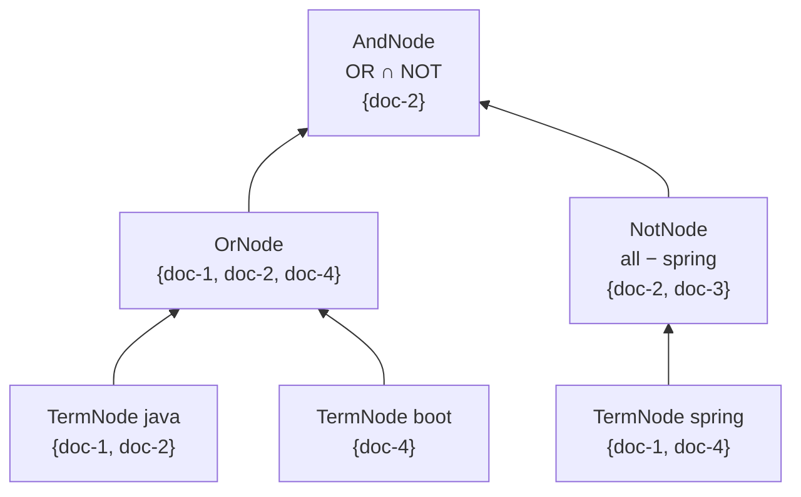

Read it from the leaves up:

1. `java` looks up its postings: `{doc-1, doc-2}`.
2. `boot` looks up its postings: `{doc-4}`.
3. The OR unions what its two children returned: `{doc-1, doc-2, doc-4}`.
4. `spring` looks up its postings: `{doc-1, doc-4}`.
5. The NOT subtracts that from every indexed document: `{1,2,3,4} − {1,4}` = `{doc-2, doc-3}`.
6. The AND intersects its two children: `{1,2,4} ∩ {2,3}` = `{doc-2}`.

**The rule that decides the shape of the code**

Each node must **return** a set of its own. It is tempting to pass one shared set down the
recursion and let every node add to it:

```java
private void evaluate(QueryNode node, Set<String> results)   // does not work
```

That works for OR, because OR only ever adds. It cannot express AND or NOT:

- **AND needs an intersection.** By the time the second child runs, the shared set already holds
  the first child's ids. The second child can only add, so `java AND spring` grows to
  `{doc-1, doc-2, doc-4}` — the union. AND silently behaves as OR.
- **NOT needs a subtraction.** A node that can only add cannot remove the documents its child
  found, so `NOT java` returns exactly the java documents: the opposite of the right answer.

So the signature has to be:

```java
private Set<String> evaluate(QueryNode node)                 // works
```

and each node combines what its children returned. One more detail follows from this: a node must
return a set nobody else owns, because its parent will call `retainAll` or `removeAll` on it. A
`TermNode` that handed back something belonging to the index would corrupt the index.

**What each node does**

| Node                | Result                                                                                                                   | Example                                        |
|---------------------|--------------------------------------------------------------------------------------------------------------------------|------------------------------------------------|
| `TermNode(t)`       | the ids in `index.getPostings(t)`                                                                                          | `java` → `{doc-1, doc-2}`                       |
| `AndNode(children)` | intersection. Evaluate every child, sort the results smallest first, then intersect — the running set only shrinks, so the fewest lookups are done. | `java AND spring` → `{doc-1}`                   |
| `OrNode(children)`  | union                                                                                                                      | `java OR boot` → `{doc-1, doc-2, doc-4}`        |
| `NotNode(child)`    | `allDocumentIds()` minus the child's set. `allDocumentIds()` is a read-only live view of the index, so it must be copied before subtracting. | `NOT java` → `{doc-3, doc-4}`                   |
| `PhraseNode(words)` | see below                                                                                                                  | `"machine learning"` → `{doc-2}`                |
| `null` root         | empty set. The parser returns a null root for blank text or a query of nothing but stop words.                             | `the` → `{}`                                    |

**Phrase matching, step by step**

This is the only node that uses the positions stored in the postings, and the only one worth
walking through slowly. Take `"state of the art"`.

1. **What the parser stored.** `TextProcessor` dropped `of` and `the` as stop words but kept the
   positions of the words it kept, so the phrase arrives as two tokens: `state@0, art@3`.
2. **Turn positions into gaps.** The gap of each word is its position minus the first word's:
   `state` has gap 0, `art` has gap 3. The gaps are what matching uses, and because they come from
   the token positions rather than from the list index, the two removed stop words are still
   accounted for. Using the list index would give a gap of 1 and match the wrong documents.
3. **Narrow to candidates.** A document can only hold the phrase if it holds every word, so
   intersect the documents of all the words first. This is cheap and leaves few documents for the
   expensive step.
4. **Check the positions.** For each candidate, take each position `p` of the *first* word and ask
   whether every other word occurs at `p + its gap`. If one position `p` works, the document
   matches.

Two documents make the difference concrete:

| Document positions   | Try p = 10                                   | Match? |
|----------------------|----------------------------------------------|--------|
| state@10, art@13     | is there an `art` at 10 + 3 = 13? yes        | yes    |
| state@10, art@11     | is there an `art` at 10 + 3 = 13? no         | no     |

Step 4 says *each* position of the first word, not the first one. In a document reading
`machine java … machine learning`, `machine` is at 0 and 5. Starting at 0 fails, because there is
no `learning` at 1. Starting at 5 succeeds. Checking only position 0 would miss the document.

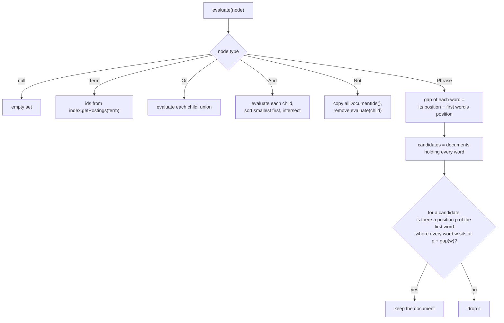

**Tests first**

Build a small index by hand for these.

- AND, OR and NOT give the expected sets of document ids.
- A phrase matches `"machine learning"`, but not a document containing `"learning machine"`.
- `"state of the art"`, stored as `[state@0, art@3]`, matches a document with `state@10, art@13`,
  but not one with `state@10, art@11`.
- A phrase matches at a later occurrence of its first word, not only the earliest.
- An unknown term gives an empty set; inside an OR, the other side still returns results.
- A query with a `null` root (nothing searchable) gives an empty set.
- NOT leaves the index untouched.

**Done when:** tests pass.

#### Implementation notes

**How it works.** `matching/MatchingEngine.java` holds the `InvertedIndex` and exposes one method,
`retrieve(Query)`, which returns `evaluate(query.root())`. `evaluate` is a `switch` over the node
type with one small helper per case:

| Case          | Helper                     | What it does                                                         |
|---------------|----------------------------|----------------------------------------------------------------------|
| `null`        | –                          | returns an empty set                                                  |
| `TermNode`    | `documentsContaining`      | collects `posting.documentID()` into a new set                        |
| `AndNode`     | `intersection`             | evaluates the children, returns early if any is empty, sorts the results smallest first, copies the smallest and `retainAll`s the rest |
| `OrNode`      | `union`                    | `addAll` of every child                                               |
| `NotNode`     | `everythingExcept`         | copies `allDocumentIds()` and `removeAll`s the child's set            |
| `PhraseNode`  | `documentsWithPhrase`      | the four steps above, with `positionsByDocument` building document → positions for one word |

Because `QueryNode` is sealed and every case is covered, the switch needs no `default`: adding a
node type later is a compile error here rather than an `IllegalStateException` at runtime.

**The mistake in the first attempt.** The first version used
`private void evaluateNode(QueryNode node, Set<String> documentIDSet)`, with each node adding into
one shared set. Nine of the nineteen tests passed, and the ten failures were all the same cause:
AND and OR had identical bodies so AND returned the union, and NOT returned its child's documents
instead of their complement. It was fixed by changing the signature to return a set, as explained
above. Worth noticing in the test run: four of the nine "passing" tests passed only because the
phrase case returned nothing, and assertions that something is *absent* are satisfied by an empty
result. A green test is not always a working feature.

**Decisions**

- **Intersect smallest first.** `rare AND common` costs the size of `rare`. The running set only
  ever shrinks, and the loop stops early once it is empty.
- **`allDocumentIds()` is copied, not used directly.** It is an unmodifiable view of the index's own
  key set: `removeAll` on it throws, and it changes as documents are indexed.
- **Phrase positions are held as a `Set<Integer>` per document,** not the `List` the posting stores,
  because the check only ever asks "is there a word at this position?" — a hash lookup rather than a
  scan of the list.
- **`retrieve(null)` throws `NullPointerException`,** matching `Indexer.indexDocument(null)`. A
  *query* with a null root is different: that is a legal empty query and returns an empty set.
- **Not implemented: rewriting `A AND NOT B` into `A − B`.** The spec suggests it as an
  optimisation. It is faster, because it never materialises the complement of B, but it makes the
  NOT case depend on its parent. Left out until T13 shows it is needed.

**Tests:** `MatchingEngineTest` has 19 tests over a seven-document hand-built index, covering the
list above plus nesting, an empty index, and an unknown word inside a phrase. The project has 191
tests, all passing.

---

### T9 — RankingAlgorithm (TF-IDF) and snippets

**Status:** Not started

**Goal:** Order the candidates from most to least relevant and build what the user sees (R7).

**Description**

- `interface RankingAlgorithm { List<SearchResult> rank(Set<String> docIds, Query query, int limit); }`
- `TfIdfRanking` (vector space model, as in the brief's background reading). For each candidate document `d` and each query term `t`:
  - `tf(t,d) = 1 + log(frequency)`
  - `idf(t) = log(N / df(t))`, where `N` = total documents and `df` = documents containing `t`
  - `score(d) = Σ tf(t,d) · idf(t)`, divided by `sqrt(length(d))` so long documents don't win just by being long
- Sort by score, highest first; break ties by title so results are stable. Keep the top `limit`.
- Build `SnippetBuilder` output **only for those top results**; building snippets is the slow part.
- `SnippetBuilder`: find the first occurrence of a query term in `rawText` and take about 80 characters on each side. Cut at word boundaries and add "…".
- *(Optional)* Add a `Bm25Ranking` strategy and compare the two in your report.

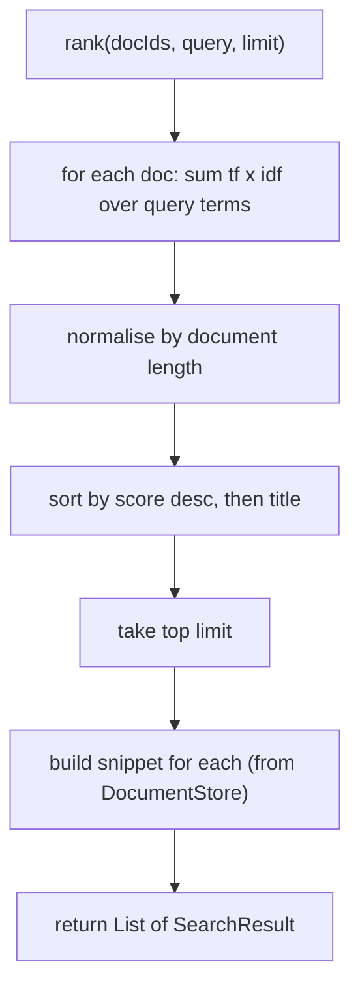

**Tests first**

- A document that mentions the term more often ranks higher (same length).
- A rare term contributes more than a common one.
- `limit` is respected.
- The snippet contains the matched term.
- Ordering is deterministic when scores tie.

**Done when:** tests pass.

---

### T10 — SearchEngineAPI facade and REST API

**Status:** Not started

**Goal:** One simple entry point (Facade) exposed over HTTP (R8).

**Description**

**Facade: `SearchEngineAPI`**

- `indexDocument(Document)`
- `indexFile(Path)`
- `removeDocument(id)`
- `search(rawQuery, page, size)` returns `SearchResponse(query, totalHits, tookMillis, results)`
- `autocomplete(input, limit)`
- `getDocument(id)`

It is wired as a Spring bean in a `@Configuration` class. The controller never touches internal classes.

**REST endpoints** (`SearchController`):

| Method | Path                            | Purpose                                        |
|--------|---------------------------------|------------------------------------------------|
| GET    | `/api/v1/search?q=&page=&size=` | Ranked results                                 |
| GET    | `/api/v1/autocomplete?q=&limit=`| Suggestions                                    |
| GET    | `/api/v1/documents/{id}`        | Document title and extracted text              |
| GET    | `/api/v1/documents/{id}/file`   | Original file (inline view or download)        |
| POST   | `/api/v1/documents` (multipart) | Upload a file: saved to `documents/` and indexed immediately |
| POST   | `/api/v1/index/refresh`         | Trigger a full rescan                          |

- A `@RestControllerAdvice` maps errors to JSON (400 for a bad request, 404 for an unknown document, 415 for an unsupported file type).
- A CORS setting lets the university website call the API from its own domain.

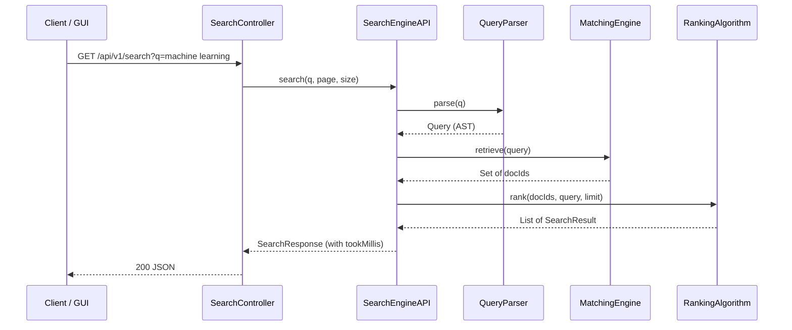

**Tests first**

- Facade unit test covering index, then search, then autocomplete.
- MockMvc tests for each endpoint, including the 400/404/415 cases.

**Done when:** `mvn spring-boot:run` and `curl "localhost:8080/api/v1/search?q=..."` return ranked JSON.

---

### T11 — Scheduled re-indexing (2-hour limit)

**Status:** Not started

**Goal:** A new or changed document becomes searchable within 2 hours, without a restart (R4).

**Description**

- When the application is ready (`ApplicationReadyEvent`), do a full scan of `documents/`.
- `RepositoryScanner.scan()` runs every `search.reindex-interval` (default 30 min, so the worst-case delay is 30 min):
  - It keeps `Map<Path, lastModifiedTime>` from the previous scan.
  - A **new** file gets indexed, a **modified** file gets re-indexed, and a **deleted** file gets removed.
  - Errors on one file are logged and skipped, so the rest of the scan continues.
- Uploads through `POST /api/v1/documents` are indexed immediately, so they never wait for the scheduler.
- *(Optional)* Add a Java `WatchService` for near-instant pickup; the scheduler stays as the safety net.

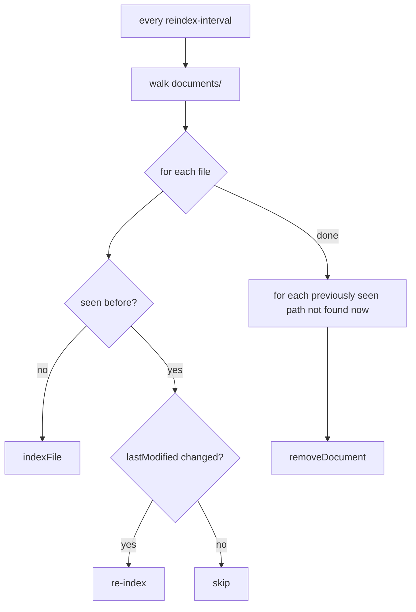

**Tests first**

Use a `@TempDir`: add a file, call `scan()`, and check it is searchable. Then modify it, then delete it, checking the result after each step.

**Done when:** tests pass, and the interval is configurable and at most 2 hours.

---

### T12 — Web GUI

**Status:** Not started

**Goal:** Show the API working, as the brief requires (R9).

**Description**

Plain HTML/CSS/JavaScript in `src/main/resources/static/`, with no framework. The pages call the REST API the same way a university website would.

- `index.html`: a search box and button, plus an autocomplete dropdown that calls `/api/v1/autocomplete`.
  - Requests are debounced by about 150 ms, and the arrow keys and Enter work.
- `results.html?q=`: opens as a **new page**. It lists the title, snippet with highlighted terms, score and "N results in X ms", with pagination.
- `document.html?id=`: shows the extracted text with the query terms highlighted, plus a link to open the original file.

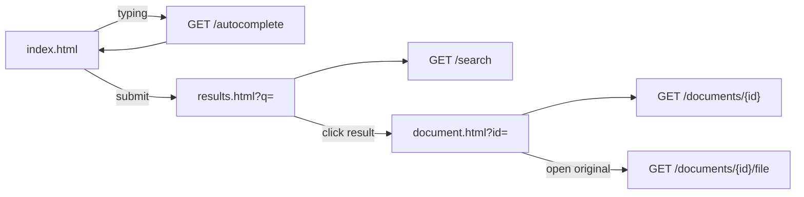

**Done when:** a full search → results → view flow works in the browser.

---

### T13 — Performance check (0.01 s)

**Status:** Not started

**Goal:** Measure and prove the response-time requirement (R2).

**Description**

- Build a test corpus of a few hundred documents; generated text is acceptable.
- A benchmark test warms up the engine, then runs a mix of term, AND, OR, phrase and autocomplete queries. It reports the median and p95 time of `search()`.
- Target: p95 under 10 ms.
- `tookMillis` is included in every search response, so the GUI shows the time live.
- If the target is missed, likely fixes:
  - precompute document norms at index time
  - start intersections from the smallest postings list
  - build snippets only for the current page
  - avoid regex in the query hot path

**Done when:** the benchmark result is recorded in this file.

---

### T14 — Index persistence (optional)

**Status:** Not started

**Goal:** Avoid re-extracting every file on each restart.

**Description:** Serialise the `InvertedIndex`, `DocumentStore` and scanner state to disk on shutdown, and load them on startup. The first scheduled scan then only picks up changes. Only worth doing if a full startup scan becomes slow.

---

### T15 — Documentation deliverables

**Status:** Not started

- Updated class diagram reflecting the changes in section 2.
- Sequence diagrams for "a document is indexed" and "a query comes in".
- README: how to run the app, the endpoint list, supported query syntax, and how to add documents.
- Report notes: design patterns used and why, the ranking formula, and benchmark results.
