# Search Engine — Task Plan

This file tracks what gets built, in what order, and how.
It is based on `CSC322_final_project.pdf` (the brief) and `CSC322_search_engine_class_diagram.pdf` (the design).

**How this file is used**

- Each task has a goal, a description, a flowchart, the tests to write first (the brief asks for test-first), and a "done when" check.
- **Owner** is a proposal: most of the work is yours. Tasks marked *Claude* are only done after you say so.
- When a task is finished, its **Status** changes and an **Implementation notes** section is added under it, explaining what was built and why.
- Every change is committed.

**Viewing the diagrams**

The diagrams are written in [Mermaid](https://mermaid.js.org/). They show as plain text in editors that don't support it.

- **IntelliJ IDEA:** go to *Settings → Plugins → Marketplace*, install **Mermaid** (by JetBrains) and restart. Then open this file in the Markdown preview: the split or preview icon at the top right of the editor. On older versions, enable it under *Settings → Languages & Frameworks → Markdown → Markdown Extensions → Mermaid*.
- **GitHub** displays Mermaid diagrams automatically.
- You can also paste a single diagram into https://mermaid.live.

---

## 1. Requirements checklist (from the brief)

| #   | Requirement                                                                                  | Covered by   |
|-----|----------------------------------------------------------------------------------------------|--------------|
| R1  | Input types: pdf, doc, docx, ppt, pptx/pps ("ppts" in the brief), xls, xlsx, txt, html, xml  | T5           |
| R2  | Query response time of 0.01 s                                                                | T3, T9, T13  |
| R3  | Query autocomplete                                                                           | T6, T10, T12 |
| R4  | New document indexed within 2 hours of being added                                           | T11          |
| R5  | Keywords extracted with their frequency; stop words excluded                                 | T2, T4       |
| R6  | Query parser that captures the query's meaning, built with a parser generator                | T7           |
| R7  | Relevant documents retrieved and ranked                                                      | T8, T9       |
| R8  | Solution delivered as an API                                                                 | T10          |
| R9  | GUI: search page (text field + button), results on a new page, user can view document content | T12          |
| R10 | ADTs, design patterns, test-first development                                                | All          |

---

## 2. Architecture

There are two pipelines, and they share the same storage.

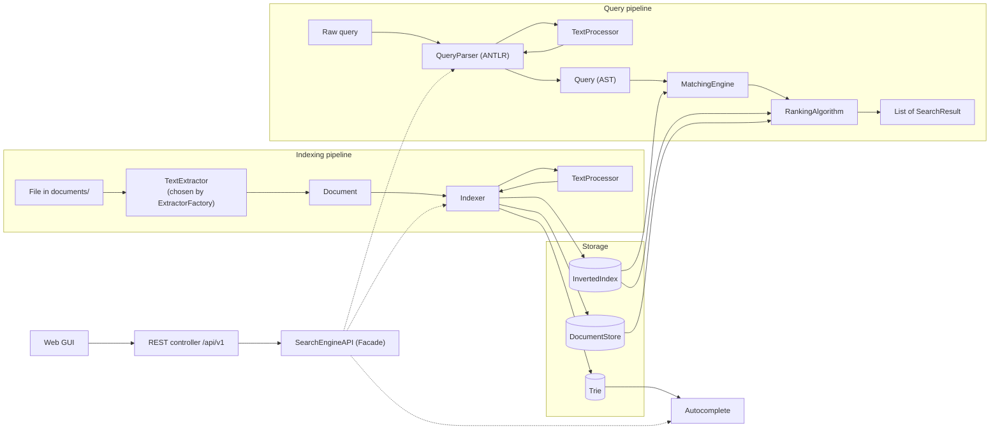

### Proposed package layout

```
com.daveai.searchengine
├── models        Token, Posting, Document, SearchResult
├── indexing      TextProcessor, Indexer, InvertedIndex, DocumentStore
├── extraction    TextExtractor, ExtractorFactory, per-format extractors, DocumentLoader
├── autocomplete  Trie, TrieNode
├── query         QueryParser, Query, ast/ (TermNode, PhraseNode, AndNode, OrNode, NotNode)
├── matching      MatchingEngine
├── ranking       RankingAlgorithm, TfIdfRanking, SnippetBuilder
├── api           SearchEngineAPI (facade), SearchController, DTOs, error handling
├── config        SearchProperties (typed search.* settings)
└── scheduling    RepositoryScanner
src/main/antlr4/com/daveai/searchengine/query/Query.g4
src/main/resources/static/   index.html, results.html, document.html
documents/                   the document repository that gets indexed
```

### Proposed changes to the class diagram

The current diagram is a good base. These gaps show up once the full requirements are applied:

1. **`Posting` gets `positions: List<Integer>`.** Phrase search (`"machine learning"`) needs to know *where* terms occur, not only how often.
2. **`InvertedIndex` and `DocumentStore` get `removeDocument(id)`.** When a file is modified or deleted, its old postings must go away (needed for R4).
3. **`InvertedIndex` keeps ranking statistics:** total document count, document frequency per term, and length per document. TF-IDF needs these, and computing them during a query would break the 0.01 s target.
4. **`Query` becomes a tree (AST)** instead of parallel `terms` / `operators` lists. The diagram's own notes predict this once an ANTLR grammar is used.
5. **`RankingAlgorithm` becomes an interface (Strategy)** with `TfIdfRanking` as the first implementation, so BM25 can be added without touching callers.
6. **`Indexer` also updates the `Trie`.** The diagram says the trie is "populated incrementally as the Indexer processes documents", but draws no arrow between them.

Design patterns used overall: **Facade** (SearchEngineAPI), **Strategy** (extractors, ranking), **Factory** (ExtractorFactory), **Composite + Interpreter** (query AST evaluated by MatchingEngine), **Visitor** (ANTLR parse tree → AST).

---

## 3. Task overview

| ID  | Task                                  | Depends on     | Proposed owner       | Status      |
|-----|---------------------------------------|----------------|----------------------|-------------|
| T0  | Project setup and dependencies        | –              | Claude               | Done        |
| T1  | Core ADTs                             | T0             | You + Claude         | Done        |
| T2  | TextProcessor                         | T1             | You                  | Done        |
| T3  | InvertedIndex and DocumentStore       | T1             | You                  | Not started |
| T4  | Indexer                               | T2, T3, T6     | You                  | Not started |
| T5  | Text extraction (Strategy + Factory)  | T1             | Claude (needs OK)    | Not started |
| T6  | Trie (autocomplete)                   | –              | You                  | Not started |
| T7  | Query grammar and parser (ANTLR)      | T2             | You                  | Not started |
| T8  | MatchingEngine                        | T3, T7         | You                  | Not started |
| T9  | RankingAlgorithm (TF-IDF) and snippets | T3, T7        | You                  | Not started |
| T10 | SearchEngineAPI facade and REST API   | T4, T5, T8, T9 | You (facade), Claude (controller, needs OK) | Not started |
| T11 | Scheduled re-indexing (2-hour limit)  | T5, T10        | Claude (needs OK)    | Not started |
| T12 | Web GUI                               | T10            | Claude (needs OK)    | Not started |
| T13 | Performance check (0.01 s)            | T10            | Claude (needs OK)    | Not started |
| T14 | Index persistence (optional)          | T3             | Open                 | Not started |
| T15 | Documentation deliverables            | All            | You + Claude         | Not started |

The core ADTs and algorithms (T1–T4 and T6–T9) are what CSC322 grades, so they are yours. That comes to about 75% of the work. The proposed Claude tasks are plumbing: dependencies, file-format libraries, scheduling, the UI and the benchmark.

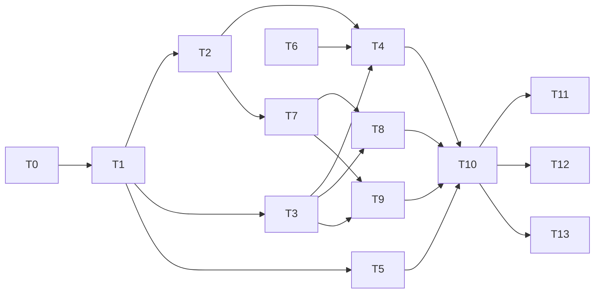

**Milestones**

- **M1 – Indexing core:** T0, T1, T2, T3, T6, T4
- **M2 – Querying:** T7, T8, T9
- **M3 – Real documents and API:** T5, T10, T11
- **M4 – Demo and proof:** T12, T13, T15

---

## 4. Tasks

### T0 — Project setup and dependencies

**Owner:** Claude · **Status:** Done

**Goal:** Add the libraries and configuration the other tasks need.

**Description**

- Add dependencies to `pom.xml`:
  - **Apache Tika**, to extract text from pdf/doc/docx/ppt/pptx/xls/xlsx/html/xml. Add `tika-core` plus only the parser modules those formats need: pdf, microsoft, html, xml and text.
  - **ANTLR 4** (`antlr4-runtime` plus `antlr4-maven-plugin`). The plugin generates the parser from `Query.g4` during `mvn compile`, which covers the "parser generator" requirement.
- Add settings to `application.yaml`:
  ```yaml
  search:
    repository-path: ./documents   # folder that gets indexed
    reindex-interval: PT30M        # well within the 2-hour limit
    autocomplete-limit: 10
  ```
- Bind those settings to a typed `SearchProperties` record that rejects invalid values at startup, including an interval over 2 hours.
- Create `documents/` with txt, html and xml samples. Binary samples (pdf and Office formats) are added in T5, where the tests can generate them.
- Create the empty package structure shown in section 2.

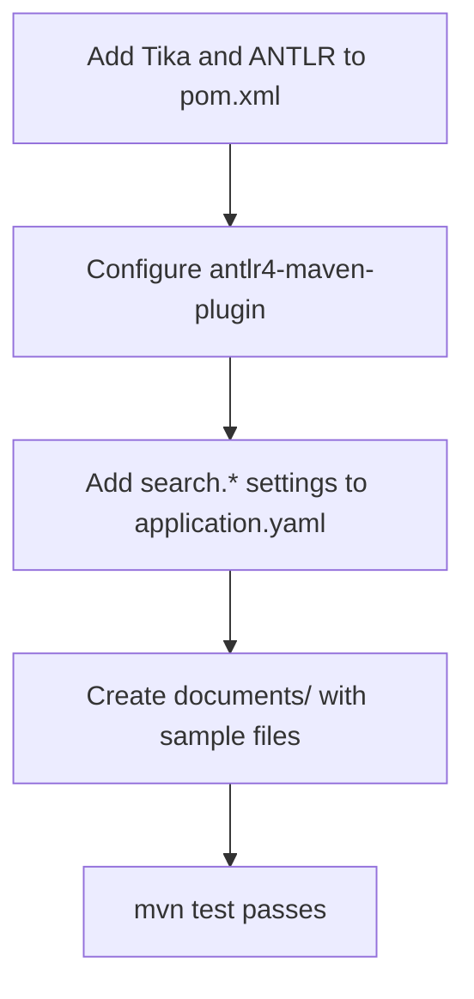

**Done when:** `mvn test` passes and `mvn spring-boot:run` starts with the new dependencies.

#### Implementation notes

**Dependencies (`pom.xml`)**

- **Tika 4.0.0:** `tika-core` plus the parser modules for pdf, Microsoft Office, html (with `tika-encoding-detector-html`), xml and text.
  - In Tika 4, `tika-parsers-standard-package` is only a POM. It pulls in about 25 parser modules, including audio, CAD, OCR, mail and crypto.
  - It also brings `jcl-over-slf4j`, which can clash with Spring's logging.
  - Listing just the modules we need keeps the build small and shows in the POM exactly which formats are supported.
- **ANTLR 4.13.2:** `antlr4-runtime` plus `antlr4-maven-plugin`, with visitor generation on and listener generation off.
  - The plugin looks for grammars in `src/main/antlr4/`.
  - Until T7 adds `Query.g4` it logs "No ANTLR 4 grammars to compile" and the build carries on.

**Settings**

- The `search.*` values in `application.yaml` are bound to the record `config/SearchProperties`. `@ConfigurationPropertiesScan` on `SearchEngineApplication` enables this.
- The record's constructor rejects:
  - missing values
  - an interval of zero or less, or more than 2 hours
  - an autocomplete limit below 1
- A bad setting therefore stops the app at startup with a clear message, instead of causing problems later.
- Spring turns `./documents` into the path `documents`. Both point to the same folder.

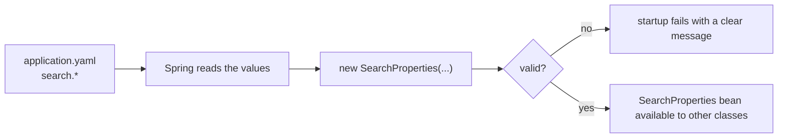

**Packages:** each package from section 2 has a `package-info.java`. Git doesn't track empty folders, so this keeps the layout in the repository, and each file states what its package is for.

**Sample documents:** `documents/welcome.txt`, `documents/computer-science-department.html` and `documents/course-catalogue.xml`.

**Tests (11, all passing)**

| Test class                     | Tests | Checks                                                              |
|--------------------------------|-------|---------------------------------------------------------------------|
| `SearchPropertiesTest`         | 6     | Validation rules, including the 2-hour limit                        |
| `SearchPropertiesBindingTests` | 1     | Values from `application.yaml` reach the record                     |
| `TikaDependencyTest`           | 3     | Tika reads text from the txt, html and xml samples. Temporary: T5 replaces it. |
| `SearchEngineApplicationTests` | 1     | The Spring context starts                                           |

**Verified**

- `mvn test`: BUILD SUCCESS.
- `mvn spring-boot:run`: Tomcat starts on port 8080 in about 6 s. `GET /` returns 404, which is expected because no endpoints exist yet.

---

### T1 — Core ADTs

**Owner:** You + Claude · **Status:** Done

**Goal:** Build the four small immutable types used by every other module.

**Description**

Use Java `record`s. They are immutable, which also makes them safe to read from query threads while indexing runs in the background. Put validation in each compact constructor.

| Type           | Fields                                                  | Rules to enforce                                   |
|----------------|---------------------------------------------------------|----------------------------------------------------|
| `Token`        | `value`, `documentId`, `position`                       | `value` not blank; `position >= 0`                 |
| `Posting`      | `documentId`, `frequency`, `positions: List<Integer>`   | `documentId` not blank; `frequency >= 1`; `frequency == positions.size()`; positions `>= 0` and strictly increasing; defensive copy of the list |
| `Document`     | `id`, `title`, `rawText`                                | `id` not blank; `rawText` not null (may be empty)  |
| `SearchResult` | `documentId`, `title`, `snippet`, `score`               | `score >= 0` and not NaN                           |

- A null value throws `NullPointerException`, for example via `Objects.requireNonNull`. An invalid value throws `IllegalArgumentException`.
- `Document` has no `sourcePath`. Its `id` is the file's path relative to `documents/`, so the original file can be found from the id.

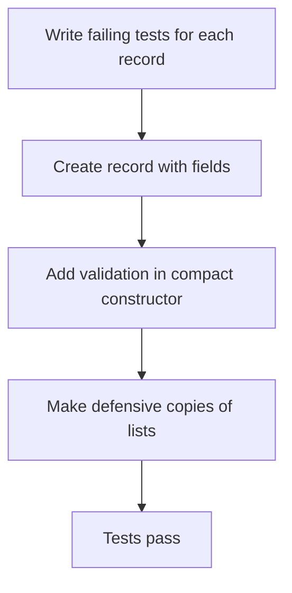

**Tests first**

Written in `src/test/java/com/daveai/searchengine/models/`: `PostingTest`, `TokenTest`, `DocumentTest` and `SearchResultTest`.

- Each rule in the table above has a test.
- A `Posting`'s positions list cannot be changed after construction, either through the original list or through the accessor.
- Two records with equal fields are `equals` and have the same `hashCode`.

**Done when:** all four records exist with tests covering every rule above.

#### Implementation notes

**Who did what:** you wrote the four records and their fields. Claude wrote the tests, then added the validation to make them pass.

**How the rules are enforced:** each record has a *compact constructor*: a constructor with no parameter list that runs before the fields are assigned. An invalid object therefore can't be created at all.

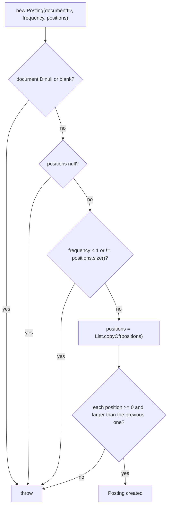

**Decisions**

- **`Posting` copies its list** with `List.copyOf`. The copy can't be modified, and changing the caller's original list no longer affects the index. The ordering check runs on this copy.
- **Positions must be strictly increasing** (for example `[1, 5, 9]`). Phrase matching in T8 relies on reading positions in order.
- **`SearchResult` rejects NaN scores.** `score < 0` alone is false for NaN, so the check is `Double.isNaN(score) || score < 0`.
- **`Token` doesn't validate `documentID`.** Query tokens (T2/T7) might not belong to any document.
- **`Document` allows empty `rawText`,** so a file with no extractable text can still be found by its title.

**Field names:** these stay as you wrote them: `documentID`, and `Token.positions` for a single position. Renaming them to `documentId` and `position` is still recommended. Use Shift+F6 in IntelliJ, which renames every usage including the tests.

**Tests:** 28 model tests plus the 11 from T0. All 39 pass (`mvn test`: BUILD SUCCESS).

---

### T2 — TextProcessor

**Owner:** You · **Status:** Done

**Goal:** Turn raw text into normalised `Token`s. The same code runs for documents and queries, so their terms always match.

**Description**

`processText` **never reads a file.** By the time it runs, the text has already been extracted from the file (T5) and is passed in as a `String`. `documentID` is only a label copied onto every `Token`, so the index knows which document each word came from.

**Once, in the constructor**

- Load `src/main/resources/static/stopwords.txt` (one word per line) into a `Set<String>`.
  - It is loaded from the classpath with `new ClassPathResource("static/stopwords.txt")`.
  - It is in `static/` on purpose: Spring serves that folder publicly, so anyone can view the list at `/stopwords.txt`.
  - A `Set` makes each "is this a stop word?" check O(1).

**On every call to `processText(text, documentID)`**

1. If `text` is null or blank, return an empty list.
2. Split `text` into words with the regex `[^\p{L}\p{N}]+`: anything that is not a letter or digit separates words. Unicode classes keep non-English letters.
3. Create an empty list `tokens` and a counter `position = 0`.
4. For each word, in order:
   1. **If the word is empty, skip it and don't count it.** Java's `split` returns `""` as the first element when the text starts with punctuation: `", hello"` gives `["", "hello"]`.
   2. Lowercase it with `toLowerCase(Locale.ROOT)`.
   3. If it is **not** a stop word, add `new Token(word, documentID, position)`. *(Optional: stem it first, e.g. Porter, so "running" matches "run".)*
   4. Add 1 to `position`. **This happens for every real word, stop words included.**
5. Return `tokens`.

**Why stop words still move the counter:** positions must describe the *original* text, or phrase search (T8) breaks. In "state of the art", "state" is at 0 and "art" is at 3. If stop words didn't count, "art" would be at 1 and look like it comes straight after "state".

**Worked example: `processText("The cat sat on the mat.", "doc-1")`**

| Word from split | Lowercased | `position` | Stop word? | Token added |
|-----------------|------------|------------|------------|-------------|
| `The`           | `the`      | 0          | yes        | –           |
| `cat`           | `cat`      | 1          | no         | `cat@1`     |
| `sat`           | `sat`      | 2          | no         | `sat@2`     |
| `on`            | `on`       | 3          | yes        | –           |
| `the`           | `the`      | 4          | yes        | –           |
| `mat`           | `mat`      | 5          | no         | `mat@5`     |

The `.` after "mat" is a separator, so it disappears. Java also drops trailing empty strings, so nothing extra appears at the end.

Result: `[Token("cat","doc-1",1), Token("sat","doc-1",2), Token("mat","doc-1",5)]`

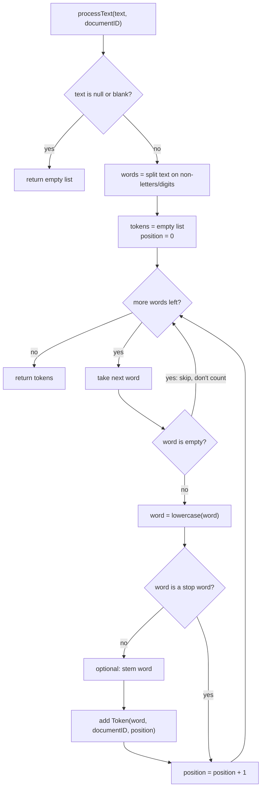

**Tests first**

- `"The cat sat on the mat"` gives `cat@1, sat@2, mat@5`.
- Punctuation and mixed case: `"Hello, WORLD!"` gives `hello@0, world@1`.
- Leading punctuation doesn't shift positions: `", hello world"` gives `hello@0, world@1`.
- Null, empty and whitespace-only text give an empty list.
- Numbers are kept: `"CSC322 project"` gives `csc322@0, project@1`.
- A string made only of stop words gives an empty list.
- Every token carries the `documentID` that was passed in.

**Done when:** tests pass and the stop-word list is loaded from the resource file.

#### Implementation notes

**Who did what:** you wrote `TextProcessor` and `stopwords.txt`. Claude reviewed it, added Javadoc and wrote the tests.

**How it works:** `indexing/TextProcessor.java` follows the steps and flowchart above.

- **Constructor:** reads `static/stopwords.txt` from the classpath once and keeps the words in a `Set`.
- **`processText`:**
  - Returns an empty list for null or empty text.
  - Splits the text with a precompiled `Pattern` (`[^\p{L}\p{N}]+`).
  - Skips empty pieces, and lowercases each word with `Locale.ROOT`.
  - Adds a `Token` for each word that isn't a stop word.
  - Increases `position` for **every** word, stop words included.

**Decisions**

- **Stop words live in `static/`** so the list is public at `http://localhost:8080/stopwords.txt`. A test makes sure it stays reachable.
- **The regex is compiled once** as a constant (`WORD_SEPARATOR`). `String.split` would recompile it on every call, and queries have a 0.01 s target.
- **`Locale.ROOT` for lowercasing.** Plain `toLowerCase()` depends on the machine's language setting (for example, Turkish turns `I` into `ı`), which would make document and query terms stop matching.
- **A null `documentID` is allowed,** so the query parser (T7) can use the same method for queries.

**Bugs found in review and fixed**

1. `position++` was inside the stop-word `if`, so stop words didn't count. "state of the art" gave `art@1` instead of `art@3`.
2. `text.isEmpty()` ran before the null check, so `null` threw `NullPointerException`.

**Tests (all 53 in the project pass)**

| Test class                 | Tests | Checks                                                                                          |
|----------------------------|-------|-------------------------------------------------------------------------------------------------|
| `TextProcessorTest`        | 13    | Positions with stop words, punctuation, capitals, leading punctuation, numbers, accented letters, null/blank text, text made only of stop words, `documentID` copied onto tokens (including null) |
| `StopWordsFileServedTests` | 1     | `GET /stopwords.txt` returns 200 and contains the stop words                                     |

---

### T3 — InvertedIndex and DocumentStore

**Owner:** You · **Status:** Not started

**Goal:** Build the storage ADTs. Term lookup must be about O(1), because the 0.01 s target depends on it.

**Description**

**InvertedIndex**

- Internal data: `Map<String, Map<String, Posting>>`, meaning term → (documentId → Posting). The inner map makes replacing and removing a document cheap.
- Operations:
  - `addPosting(term, posting)`
  - `getPostings(term)`: returns an unmodifiable collection, **never null**, and empty when the term is unknown.
  - `removeDocument(documentId)`
  - `documentFrequency(term)`
  - `documentCount()`
  - `documentLength(documentId)`
  - `allDocumentIds()`: needed for `NOT` queries.
- For removal, keep a reverse map `documentId → Set<term>` so you don't scan every term.
- Concurrency: indexing runs on a background thread while searches read. Use `ConcurrentHashMap`, or guard writes with a `ReentrantReadWriteLock`, and write down which you chose and why.

**DocumentStore**

- `save(doc)`, `get(id)` returning `Optional<Document>`, `remove(id)`, `contains(id)`, `size()`.

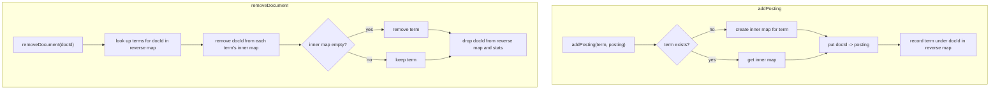

**Tests first**

- An unknown term returns an empty collection, not null.
- Adding postings for two documents under one term returns both.
- After `removeDocument`, the document is gone from every term, and terms with no documents left are gone too.
- `documentFrequency` and `documentCount` stay correct after adds and removes.
- The returned collection cannot be modified by the caller.

**Done when:** both ADTs pass their tests, and the concurrency choice is recorded in the implementation notes.

---

### T4 — Indexer

**Owner:** You · **Status:** Not started

**Goal:** Run the whole indexing pipeline for one `Document`.

**Description**

1. If the document id is already indexed, call `index.removeDocument(id)` first. This makes re-indexing a modified file safe.
2. `tokens = processor.processText(doc.rawText(), doc.id())`. Also include the title, so titles are searchable.
3. Group tokens by `value`. Each group becomes one `Posting(docId, count, positions)`.
4. `index.addPosting(term, posting)` for each group.
5. Record the document length (the token count) for ranking.
6. `store.save(doc)`.
7. `trie.insert(term)` for each unique term.

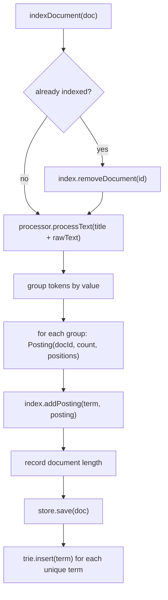

**Tests first**

Use in-memory `Document`s here, not files; file handling is T5.

- A document with `"java java spring"` gives `java` frequency 2 with positions `[0,1]`, and `spring` frequency 1.
- Re-indexing the same id with new text removes the old terms.
- After indexing, the document can be fetched from `DocumentStore` and its terms appear in the trie.
- Stop words never reach the index.

**Done when:** tests pass using real `TextProcessor`, `InvertedIndex`, `DocumentStore` and `Trie` instances.

---

### T5 — Text extraction (Strategy + Factory)

**Owner:** Claude (needs OK) · **Status:** Not started

**Goal:** Turn a file of any supported format into a `Document`, without the Indexer knowing about formats.

**Description**

- `interface TextExtractor { Set<String> supportedExtensions(); ExtractedContent extract(Path file); }`
- Implementations, one Strategy per format family:
  - `PlainTextExtractor`: txt
  - `PdfExtractor`: pdf
  - `WordExtractor`: doc, docx
  - `PowerPointExtractor`: ppt, pptx, pps, ppsx
  - `ExcelExtractor`: xls, xlsx
  - `HtmlExtractor`: html, htm (the `<title>` becomes the document title)
  - `XmlExtractor`: xml

  Each wraps Tika. The separate classes keep the Strategy pattern visible and let each format tune its output.
- `ExtractorFactory.forFile(Path)` picks the extractor by extension and throws `UnsupportedDocumentTypeException` otherwise.
- `DocumentLoader.load(Path)` gives a `Document`:
  - id = path relative to `documents/`
  - title = metadata title, or the file name as a fallback
  - rawText = extracted text

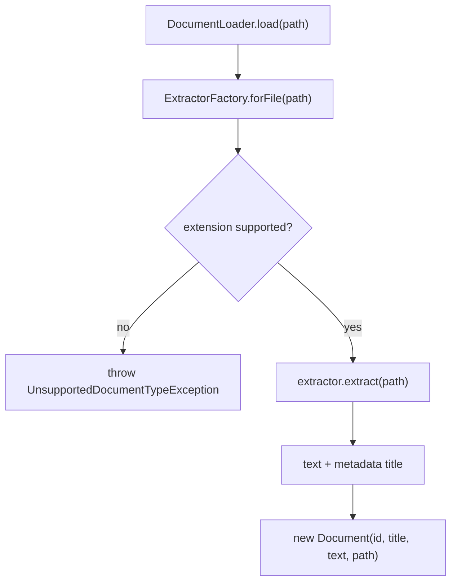

**Tests first**

- One sample file per format in `src/test/resources/samples/`. Each extracts a known sentence.
- An unknown extension throws.
- A file without a metadata title falls back to its file name.

**Done when:** every format in R1 has a passing extraction test.

---

### T6 — Trie (autocomplete)

**Owner:** You · **Status:** Not started

**Goal:** Return suggestions for a prefix quickly (R3).

**Description**

- `TrieNode { Map<Character, TrieNode> children; boolean isWord; int weight; }`
- `insert(word)`: walk or create nodes, then mark the last node as a word and increment its `weight`. Weight counts how many documents contain the word, so common terms rank first.
- `getSuggestions(prefix, limit)`:
  1. Lowercase the prefix.
  2. Walk to the prefix node. If it is missing, return an empty list.
  3. Collect every word below it with a depth-first search.
  4. Sort by weight, highest first, then alphabetically.
  5. Return the top `limit`.
- For multi-word input like `"machine lea"`, the API (T10) completes only the last word and keeps the rest.
- *(Optional, for speed)* Store the top-N suggestions on each node while inserting, so a lookup doesn't have to search the whole subtree.

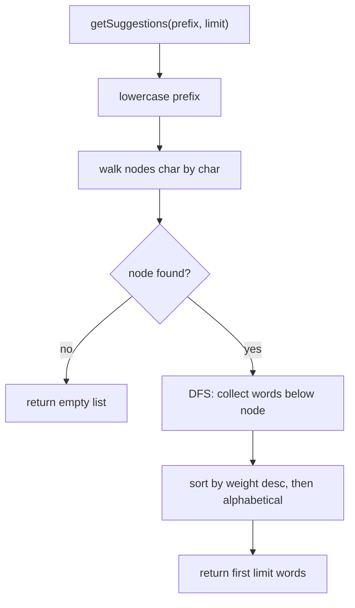

**Tests first**

- After inserting `java`, `javascript`, `jar`, the prefix `ja` returns all three, and `jav` returns two.
- An unknown prefix returns an empty list. An empty prefix returns an empty list, or the top words; pick one and document it.
- A word inserted more often ranks first.
- `limit` is respected.

**Done when:** tests pass.

---

### T7 — Query grammar and parser (ANTLR)

**Owner:** You · **Status:** Not started

**Goal:** Parse raw query text into a tree that captures what the query means (R6, and the parser-generator requirement).

**Description**

1. **Grammar** in `src/main/antlr4/com/daveai/searchengine/query/Query.g4`. Starting sketch:
   ```antlr
   grammar Query;

   query   : orExpr? EOF ;
   orExpr  : andExpr (OR andExpr)* ;
   andExpr : notExpr (AND? notExpr)* ;      // "cat dog" means cat AND dog
   notExpr : NOT notExpr | primary ;
   primary : LPAREN orExpr RPAREN | PHRASE | TERM ;

   OR     : 'OR' | '|' ;
   AND    : 'AND' | '&' ;
   NOT    : 'NOT' | '-' ;
   LPAREN : '(' ;
   RPAREN : ')' ;
   PHRASE : '"' ~["]* '"' ;
   TERM   : [\p{L}\p{N}]+ ;
   WS     : [ \t\r\n]+ -> skip ;
   ```
   Precedence comes from how the rules nest: NOT binds tightest, then AND, then OR. Operators are uppercase only, so a lowercase "or" is just a word, and a stop word.
2. **AST:** `sealed interface QueryNode permits TermNode, PhraseNode, AndNode, OrNode, NotNode`. Also `record Query(String rawText, QueryNode root)` with a helper `terms()` that the ranker uses.
3. **Visitor:** `QueryAstBuilder extends QueryBaseVisitor<QueryNode>` turns the ANTLR parse tree into the AST. It runs every term through `TextProcessor`. Terms that are stop words are dropped, and an AND/OR left with one child collapses to that child.
4. **Errors:** users type messy queries. On a syntax error, such as `(cat` with no closing bracket, fall back to treating every word as an AND of terms instead of failing the request.

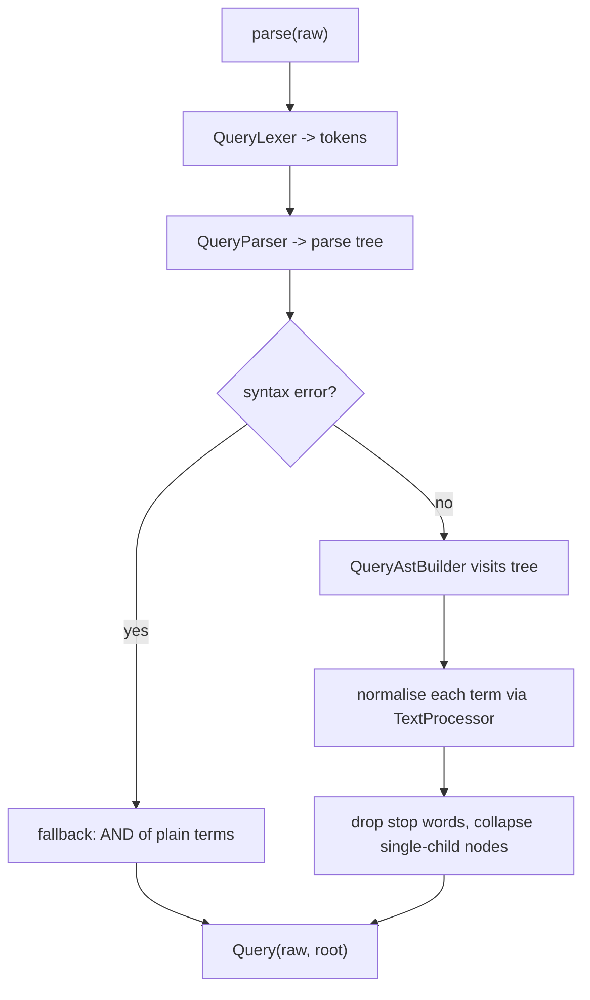

**Tests first**

- `cat dog` gives `And(cat, dog)`.
- `cat OR dog` gives `Or(cat, dog)`.
- `a OR b c` gives `Or(a, And(b, c))`, which checks precedence.
- `cat -dog` and `cat NOT dog` both give `And(cat, Not(dog))`.
- `"Machine Learning"` gives `Phrase(machine, learning)`.
- `the AND cat` gives `Term(cat)`.
- `(cat` does not throw.

**Done when:** tests pass and the parser is generated by Maven during the build, not checked in.

---

### T8 — MatchingEngine

**Owner:** You · **Status:** Not started

**Goal:** Find the set of documents that satisfy the query tree.

**Description**

Evaluate the AST recursively. This is the Interpreter pattern.

| Node                 | Result                                                                                           |
|----------------------|--------------------------------------------------------------------------------------------------|
| `TermNode(t)`        | ids of `index.getPostings(t)`                                                                    |
| `AndNode(children)`  | intersection. Start from the smallest set; this matters for speed.                              |
| `OrNode(children)`   | union                                                                                            |
| `NotNode(child)`     | `allDocumentIds() − child`. Inside an AND, prefer `left − child`, which is cheaper.              |
| `PhraseNode(words)`  | intersect the documents of all words, then keep only documents where the positions are consecutive |

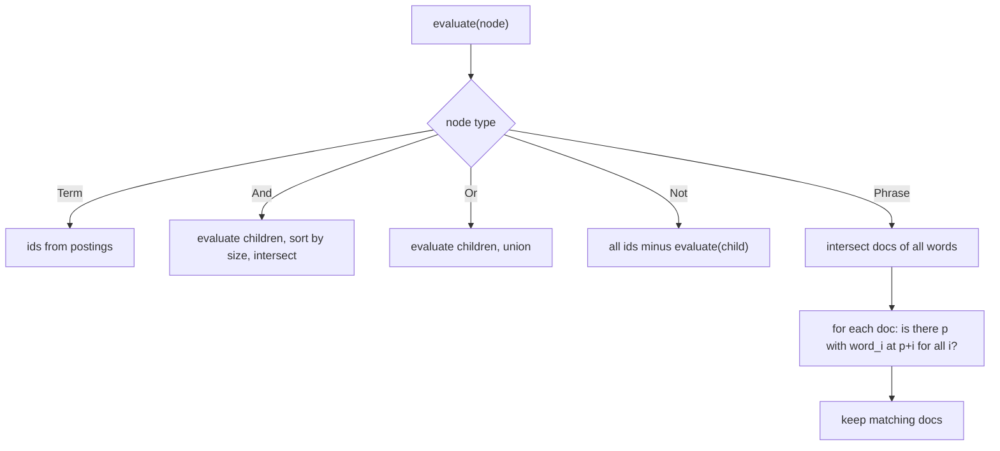

**Tests first**

Build a small index by hand for these.

- AND, OR and NOT give the expected id sets.
- A phrase matches `"machine learning"` but not a document containing `"learning machine"`.
- An unknown term gives an empty set; inside an OR, the other side still returns results.
- An empty query gives an empty set.

**Done when:** tests pass.

---

### T9 — RankingAlgorithm (TF-IDF) and snippets

**Owner:** You · **Status:** Not started

**Goal:** Order the candidates from most to least relevant and build what the user sees (R7).

**Description**

- `interface RankingAlgorithm { List<SearchResult> rank(Set<String> docIds, Query query, int limit); }`
- `TfIdfRanking` (vector space model, as in the brief's background reading). For each candidate document `d` and each query term `t`:
  - `tf(t,d) = 1 + log(frequency)`
  - `idf(t) = log(N / df(t))`, where `N` = total documents and `df` = documents containing `t`
  - `score(d) = Σ tf(t,d) · idf(t)`, divided by `sqrt(length(d))` so long documents don't win just by being long
- Sort by score, highest first; break ties by title so results are stable. Keep the top `limit`.
- Build `SnippetBuilder` output **only for those top results**; building snippets is the slow part.
- `SnippetBuilder`: find the first occurrence of a query term in `rawText` and take about 80 characters on each side. Cut at word boundaries and add "…".
- *(Optional)* Add a `Bm25Ranking` strategy and compare the two in your report.

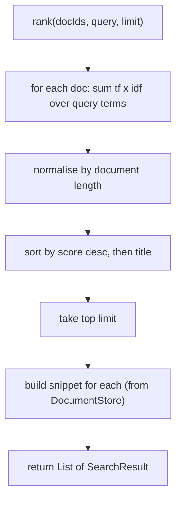

**Tests first**

- A document that mentions the term more often ranks higher (same length).
- A rare term contributes more than a common one.
- `limit` is respected.
- The snippet contains the matched term.
- Ordering is deterministic when scores tie.

**Done when:** tests pass.

---

### T10 — SearchEngineAPI facade and REST API

**Owner:** You (facade), Claude (controller, needs OK) · **Status:** Not started

**Goal:** One simple entry point (Facade) exposed over HTTP (R8).

**Description**

**Facade: `SearchEngineAPI`**

- `indexDocument(Document)`
- `indexFile(Path)`
- `removeDocument(id)`
- `search(rawQuery, page, size)` returns `SearchResponse(query, totalHits, tookMillis, results)`
- `autocomplete(input, limit)`
- `getDocument(id)`

It is wired as a Spring bean in a `@Configuration` class. The controller never touches internal classes.

**REST endpoints** (`SearchController`):

| Method | Path                            | Purpose                                        |
|--------|---------------------------------|------------------------------------------------|
| GET    | `/api/v1/search?q=&page=&size=` | Ranked results                                 |
| GET    | `/api/v1/autocomplete?q=&limit=`| Suggestions                                    |
| GET    | `/api/v1/documents/{id}`        | Document title and extracted text              |
| GET    | `/api/v1/documents/{id}/file`   | Original file (inline view or download)        |
| POST   | `/api/v1/documents` (multipart) | Upload a file: saved to `documents/` and indexed immediately |
| POST   | `/api/v1/index/refresh`         | Trigger a full rescan                          |

- A `@RestControllerAdvice` maps errors to JSON (400 for a bad request, 404 for an unknown document, 415 for an unsupported file type).
- A CORS setting lets the university website call the API from its own domain.

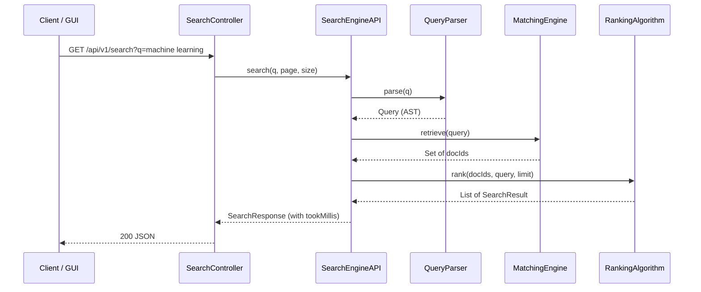

**Tests first**

- Facade unit test covering index, then search, then autocomplete.
- MockMvc tests for each endpoint, including the 400/404/415 cases.

**Done when:** `mvn spring-boot:run` and `curl "localhost:8080/api/v1/search?q=..."` return ranked JSON.

---

### T11 — Scheduled re-indexing (2-hour limit)

**Owner:** Claude (needs OK) · **Status:** Not started

**Goal:** A new or changed document becomes searchable within 2 hours, without a restart (R4).

**Description**

- When the application is ready (`ApplicationReadyEvent`), do a full scan of `documents/`.
- `RepositoryScanner.scan()` runs every `search.reindex-interval` (default 30 min, so the worst-case delay is 30 min):
  - It keeps `Map<Path, lastModifiedTime>` from the previous scan.
  - A **new** file gets indexed, a **modified** file gets re-indexed, and a **deleted** file gets removed.
  - Errors on one file are logged and skipped, so the rest of the scan continues.
- Uploads through `POST /api/v1/documents` are indexed immediately, so they never wait for the scheduler.
- *(Optional)* Add a Java `WatchService` for near-instant pickup; the scheduler stays as the safety net.

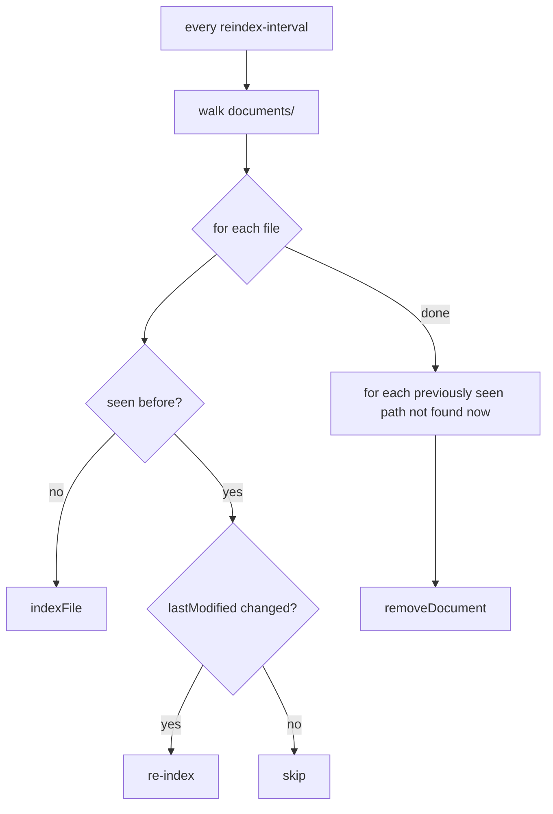

**Tests first**

Use a `@TempDir`: add a file, call `scan()`, and check it is searchable. Then modify it, then delete it, checking the result after each step.

**Done when:** tests pass, and the interval is configurable and at most 2 hours.

---

### T12 — Web GUI

**Owner:** Claude (needs OK) · **Status:** Not started

**Goal:** Show the API working, as the brief requires (R9).

**Description**

Plain HTML/CSS/JavaScript in `src/main/resources/static/`, with no framework. The pages call the REST API the same way a university website would.

- `index.html`: a search box and button, plus an autocomplete dropdown that calls `/api/v1/autocomplete`.
  - Requests are debounced by about 150 ms, and the arrow keys and Enter work.
- `results.html?q=`: opens as a **new page**. It lists the title, snippet with highlighted terms, score and "N results in X ms", with pagination.
- `document.html?id=`: shows the extracted text with the query terms highlighted, plus a link to open the original file.

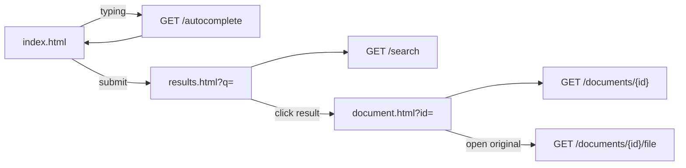

**Done when:** a full search → results → view flow works in the browser.

---

### T13 — Performance check (0.01 s)

**Owner:** Claude (needs OK) · **Status:** Not started

**Goal:** Measure and prove the response-time requirement (R2).

**Description**

- Build a test corpus of a few hundred documents; generated text is acceptable.
- A benchmark test warms up the engine, then runs a mix of term, AND, OR, phrase and autocomplete queries. It reports the median and p95 time of `search()`.
- Target: p95 under 10 ms.
- `tookMillis` is included in every search response, so the GUI shows the time live.
- If the target is missed, likely fixes:
  - precompute document norms at index time
  - start intersections from the smallest postings list
  - build snippets only for the current page
  - avoid regex in the query hot path

**Done when:** the benchmark result is recorded in this file.

---

### T14 — Index persistence (optional)

**Owner:** Open · **Status:** Not started

**Goal:** Avoid re-extracting every file on each restart.

**Description:** Serialise the `InvertedIndex`, `DocumentStore` and scanner state to disk on shutdown, and load them on startup. The first scheduled scan then only picks up changes. Only worth doing if a full startup scan becomes slow.

---

### T15 — Documentation deliverables

**Owner:** You + Claude · **Status:** Not started

- Updated class diagram reflecting the changes in section 2.
- Sequence diagrams for "a document is indexed" and "a query comes in".
- README: how to run the app, the endpoint list, supported query syntax, and how to add documents.
- Report notes: design patterns used and why, the ranking formula, and benchmark results.
